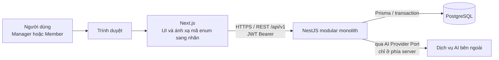
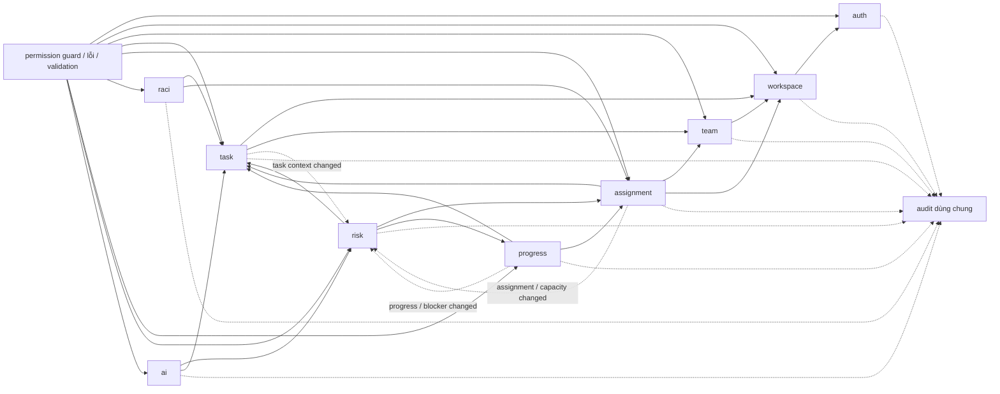
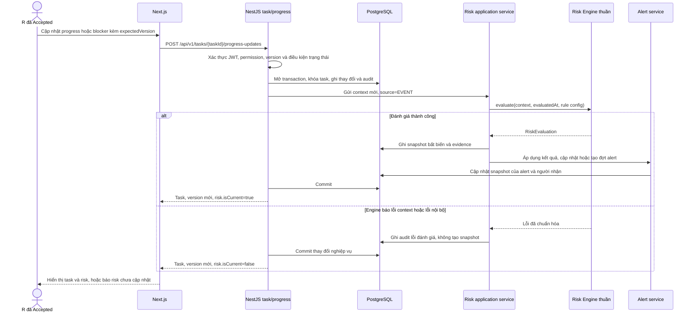
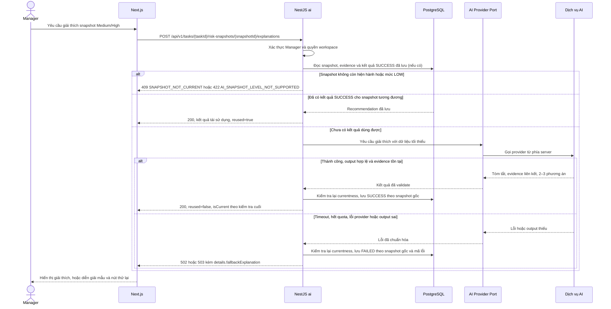

# CWRM-11 — Kiến trúc hệ thống

**Trạng thái:** bản thiết kế cập nhật cùng contract 0.2.0-draft ngày 12/11/2026; đã ghi nhận phản hồi của Hiệp và Ban. ADR kỹ thuật được Tech Lead chấp thuận ngày 11/11/2026. Phạm vi nghiệp vụ theo Scope v0.1; không ghi nhận phê duyệt toàn nhóm.

## 1. Ranh giới và cấu trúc triển khai

CWRM chạy trên web với Next.js, backend NestJS, PostgreSQL và ORM Prisma theo D1–D5 trong [ADR-001](adr/ADR-001-tech-stack.md). Backend là modular monolith: module nghiệp vụ có ranh giới rõ nhưng cùng tiến trình và cùng cơ sở dữ liệu. REST API có tiền tố /api/v1. Không thêm dịch vụ triển khai riêng, SSO, email, realtime hay workflow ngoài Scope.



Frontend chỉ giữ token cần cho phiên client và hiển thị dữ liệu theo quyền API. Guard backend là ranh giới phân quyền thực; ẩn nút trên UI không thay thế kiểm tra quyền. Backend không gửi password, API key, email hoặc định danh không cần thiết sang AI. Provider/model chưa được ADR-001 lựa chọn; CWRM-16 chốt phần đó.

## 2. Phân chia module

Chín module dưới đây là các module nghiệp vụ theo acceptance criteria. Các thành phần dùng chung (guard, audit, lỗi, cấu hình) không tạo thành actor hay quyền mới.

| Module | Trách nhiệm trong CWRM | Sxx | Người phụ trách dự kiến |
|---|---|---|---|
| auth | Đăng ký, đăng nhập, băm password, JWT access token, hồ sơ cơ bản; không SSO/refresh token/email | S01 | Khôi (API); Hiệp (UI) |
| workspace | Workspace, membership Manager/Member, lời mời trong ứng dụng cho tài khoản đã đăng ký, không gỡ Manager cuối | S01 | Khôi (API/DB); Bảo (nghiệp vụ) |
| team | Team, thành viên team, role/skill theo workspace, nhãn thành viên và điều kiện eligibility | S02 | Khôi (API/DB); Hiệp (UI) |
| task | Tạo/sửa task, ngữ cảnh, một A, assignment mode, số người cần, task status qua hành động, dependency guard; chứa milestone và dependency | S03, S09 | Khôi (API/DB); Hiệp (UI) |
| assignment | Direct Assignment và Open Work; request, eligibility, capacity, Accept/Decline/Approve/Reject/Withdraw; assignment không làm task tự Start | S04, S05 | Khôi (API/DB); Hiệp (UI) |
| raci | A trên task, R dẫn xuất từ assignment Accepted đang hiệu lực, C/I, chuyển A; review/approve/return theo A | S06 | Khôi (API/DB); Bảo (nghiệp vụ) |
| progress | Progress/effort/kết quả, blocker, đợt Blocked và comment; không cho progress 100 tự Done | S07, S08 | Khôi (API/DB); Hiệp (UI) |
| risk | Thu thập ngữ cảnh, gọi Risk Engine thuần, lưu snapshot/evidence, lịch giờ, dashboard, alert/read state; không cho nhập risk | S10, S11 | Ban (rule/evidence); Khôi (tích hợp DB/API) |
| ai | Port nhà cung cấp AI, kiểm tra quyền/snapshot, gọi giải thích, kiểm tra liên kết evidence, lưu recommendation và fallback; không thay task/risk | S12 | Ban (AI/QA); Khôi (backend port); Hiệp (UI) |

### Vị trí thành phần được dùng chung

- **Milestone** và **dependency** thuộc task: cùng phạm vi team và là dữ liệu ngữ cảnh/điều kiện task.
- **Blocker**, **blocked periods** và **comment** thuộc progress: chúng phát sinh từ quá trình thực hiện.
- **Alert**, trang dashboard risk và lịch đánh giá giờ thuộc risk.
- **Audit log** là hạ tầng dùng chung, được gọi từ use case của các module khi ghi thay đổi quan trọng. Audit không phải module nghiệp vụ có quyền riêng.
- **Permission guard**, xác thực JWT, validation, exception filter và correlation/request logging nằm ở lớp nền NestJS dùng chung. Guard tra membership/quan hệ nghiệp vụ qua interface của module sở hữu dữ liệu.
- **Cấu hình** nằm ở cấu hình backend theo môi trường; secrets chỉ được đọc ở server runtime. Không lưu secrets trong mã nguồn, seed, OpenAPI example hay frontend.
- **PostgreSQL** lưu các module trong cùng schema logic; mỗi module sở hữu thao tác ghi trên các bảng của mình. Đọc liên module dùng service/interface hoặc query đã được thống nhất, không cho module khác tùy tiện ghi bảng.

## 3. Quan hệ phụ thuộc giữa module

Mũi tên liền biểu thị dùng interface/dữ liệu của module khác; mũi tên nét đứt biểu thị sự kiện nghiệp vụ sau khi thay đổi commit. task không phụ thuộc ngược vào risk; Risk Engine được gọi bởi application layer khi có sự kiện cần đánh giá.



Điều phối liên module nằm ở application service/use case NestJS. Event không tạo hàng đợi realtime; MVP có đánh giá đồng bộ sau thay đổi và một tác vụ lịch mỗi giờ. Risk Engine chỉ là hàm xác định, không truy cập DB, HTTP hoặc đồng hồ toàn cục.

## 4. Risk Engine và interface nội bộ

Ban sở hữu rule engine. Backend cấp `RiskTaskContext`, thời điểm đánh giá UTC và cấu hình rule có phiên bản cho hàm thuần. Engine trả mức risk/base, rule IDs, evidence, thời điểm đánh giá và phiên bản rule; engine không lấy giờ toàn cục, đọc DB hay gọi HTTP. Backend tính `inputFingerprint`, cấp `id` và `triggerSource` khi ghép kết quả để lưu snapshot cùng evidence và cập nhật alert. Cùng context, `evaluatedAt` và cấu hình rule phải cho cùng kết quả. Chỉ task chưa DONE được đánh giá; task Done giữ snapshot lịch sử và rời dashboard risk đang hoạt động.

### Kiểu context đầu vào

```ts
type RiskEvaluationSource = "EVENT" | "HOURLY" | "MANUAL";

type RiskTaskContext = {
  taskId: string;
  status: "TO_DO" | "IN_PROGRESS" | "BLOCKED" | "REVIEW";
  progress: number;                 // số nguyên 0..100
  deadlineAt: string;                // UTC ISO-8601
  priority: "LOW" | "MEDIUM" | "HIGH" | "CRITICAL";
  deadlineType: "FIXED" | "FLEXIBLE";
  evaluatedAt: string;               // UTC ISO-8601
  blockedSince: string | null;       // đầu đợt Blocked đang mở, UTC; null nếu không Blocked
  blockedHours: number;              // suy ra từ blockedSince và evaluatedAt; 0 nếu không Blocked
  hasAcceptedResponsible: boolean;
  maxWorkload: number;               // workload lớn nhất trong các R hiệu lực
  predecessorStates: Array<{
    taskId: string;
    status: "TO_DO" | "IN_PROGRESS" | "BLOCKED" | "REVIEW" | "DONE";
    deadlineAt: string;
  }>;
  affectedTasks: number;             // successor chưa Done ở mọi tầng, không đếm trùng
  milestone: null | {
    milestoneId: string;
    deadlineAt: string;
    remainingHours: number;
  };
  activeResponsibleWorkloads: Array<{
    userId: string;                  // chỉ nội bộ; không gửi nguyên định danh cho AI
    activeTaskCount: number;
  }>;
  openBlockers: Array<{
    blockerId: string;
    openedAt: string;
  }>;
  ruleConfiguration: {
    ruleVersion: string;
  };
};
```

remainingHours được tính từ deadlineAt và evaluatedAt; blockedHours là thời gian liên tục từ đầu đợt Blocked đang mở, không reset khi chỉ giải quyết một trong nhiều blocker. R06/R07 dùng predecessor trực tiếp; affectedTasks dùng successor mọi tầng, đếm task khác nhau và loại task Done. maxWorkload đếm task chưa Done mà người đó là R Accepted hiệu lực, thuộc cùng workspace và có status To Do/In Progress/Blocked; Review không tính workload hoạt động theo Scope.

### Kiểu kết quả engine

```ts
type RiskLevel = "LOW" | "MEDIUM" | "HIGH";
type RiskRuleId = string; // service chỉ chấp nhận pattern ^R(0[1-9]|1[0-2])$

type RiskEvaluation = {
  riskLevel: RiskLevel;
  baseLevel: RiskLevel;
  evaluatedAt: string;
  ruleVersion: string;
  triggeredRules: RiskRuleId[];
  evidence: Array<{
    id: string;                      // ổn định trong snapshot, ví dụ ev-01
    source: "task" | "evaluation" | "rule" | "impact";
    ruleId?: RiskRuleId;
    field: string;
    value: string | number | boolean | null;
    unit?: string;
  }>;
};

type RiskSnapshot = RiskEvaluation & {
  id: string;
  taskId: string;
  inputFingerprint: string;
  triggerSource: RiskEvaluationSource;
};
```

Hợp đồng này cho phép R01–R12 (không khóa vào R01–R03 của POC). Không tính xác suất và không nhận mức risk từ Manager. Đầu vào thiếu/sai miền sinh lỗi dữ liệu rõ; không thay bằng 0 và không tạo snapshot giả. ruleVersion được cấu hình/version hóa phía backend, không suy ra từ tên provider.

### Fingerprint đầu vào — định dạng đã thống nhất, chi tiết chuẩn hóa còn mở

CWRM-15 nêu mục đích của `inputFingerprint` là phát hiện kết quả AI đã cũ khi dữ liệu task thay đổi. Theo phản hồi của Ban, backend tính SHA-256 trên JSON chuẩn hóa của dữ liệu gốc và kết quả có dạng `sha256:<hex-64>`.

- Backend băm **dữ liệu gốc** có thể làm đổi kết quả rule: taskId, status, progress, deadlineAt, priority, deadlineType, hasAcceptedResponsible, blockedSince, openBlockers (blockerId, openedAt), predecessorStates (taskId, status, deadlineAt), affectedTasks, milestone (milestoneId, deadlineAt, hoặc null), activeResponsibleWorkloads (userId nội bộ, activeTaskCount) và `ruleVersion`.
- Không băm `evaluatedAt` và các giá trị suy ra từ thời điểm đánh giá (`remainingHours`, `blockedHours`, `milestone.remainingHours`). Nếu băm các giá trị này, fingerprint đổi ở mọi lần đánh giá dù dữ liệu task không đổi, và việc tái sử dụng kết quả AI theo Scope S12 không bao giờ xảy ra.
- Không băm tên, email, nội dung mô tả hay dữ liệu không tham gia rule.
- Mảng biểu diễn tập hợp được sắp theo khóa ổn định; mảng có thứ tự ý nghĩa giữ nguyên thứ tự. Quy tắc chính xác cho null/thiếu và thứ tự từng mảng, cùng fixture có digest cố định để đối chiếu, sẽ được chốt khi triển khai Risk Engine trong backend.

Thời gian trôi có thể làm đổi rule kích hoạt trong khi fingerprint giữ nguyên, nên tính hiện hành không chỉ dựa vào fingerprint:

- Snapshot là hiện hành (isCurrent=true) khi nó là snapshot mới nhất của task, lần đánh giá gần nhất thành công và fingerprint tính trên dữ liệu hiện tại bằng inputFingerprint của snapshot.
- Một kết quả AI là hiện hành khi snapshot hiện hành của cùng task có cùng `inputFingerprint`, `riskLevel`, `baseLevel` và tập `triggeredRules` với snapshot mà kết quả đó gắn vào. Khi tái sử dụng, backend cũng kiểm tra evidence được tham chiếu còn tồn tại và giữ nguyên ý nghĩa; evidence đổi nghĩa hoặc biến mất thì cần đánh giá lại việc dùng kết quả đã lưu.

Chi tiết null/thiếu, thứ tự cụ thể của từng mảng và fixture digest cố định còn mở để chốt trong quá trình triển khai backend.

## 5. Đánh giá lại Risk và Alert

Risk được đánh giá lại theo ba nguồn:

1. **Sự kiện dữ liệu (EVENT):** thay đổi task status/progress/deadline/priority/deadline type, assignment/R, blocker/đợt Blocked, dependency, milestone hoặc workload có liên quan. Khi successor/predecessor hay workload đổi, đánh giá các task bị ảnh hưởng theo Scope.
2. **Lịch giờ (HOURLY):** kiểm tra task chưa Done để thời gian trôi có thể kích hoạt/ngắt rule ngay cả khi không có cập nhật.
3. **Manager bấm (MANUAL):** đánh giá lại task được phép xem trong workspace.

Snapshot bất biến gồm level, base level, evaluatedAt, ruleVersion, rule kích hoạt, context JSON, fingerprint và nguồn trigger. Evidence là hàng con của snapshot, với ID ổn định trong snapshot. Alert chỉ có tối đa một đợt OPEN cho mỗi task; lần đánh giá khi đang OPEN cập nhật snapshot/evidence hiện hành; Low hoặc Done đóng đợt, tăng lại sau đó tạo đợt mới. Đọc là trạng thái theo từng người nhận (A và R Accepted đang hiệu lực), tách khỏi resolve. Lỗi đánh giá không được trình bày snapshot cũ như mới: API trả lỗi/trạng thái cũ rõ ràng và isCurrent=false; snapshot hợp lệ gần nhất vẫn được giữ để tra cứu.

## 6. Các quy ước cắt ngang

### Phân quyền

Quyền hệ thống chỉ có MANAGER và MEMBER trên từng workspace. Role/skill chuyên môn và nhãn RACI (A, R, C, I) không cấp quyền. A luôn là Manager workspace và là thành viên team; R dẫn xuất từ assignment ACCEPTED chưa kết thúc; C/I tùy chọn. Member chỉ xem task/Open Work thuộc team mình; Manager trong workspace xem mọi team. Chỉ R đang Accepted cập nhật tiến độ/effort, bắt đầu, báo blocker và gửi kết quả; A đang hiệu lực duyệt Review/Done hoặc trả lại. Manager có thể làm can thiệp quản lý với lý do qua thao tác riêng. Quyền được kiểm tra lại trên mọi request, không tin userId do client gửi.

Bảng đối chiếu Scope 6.3. Các mã viết hoa là giá trị x-permission, được định nghĩa ở phần mô tả của [openapi.yaml](../api/openapi.yaml):

| Thao tác | Quyền/điều kiện API |
|---|---|
| Tạo workspace | Bất kỳ tài khoản AUTHENTICATED; người tạo thành Manager |
| Quản lý team, membership, role/skill | WORKSPACE_MANAGER trong workspace liên quan |
| Xem role/skill gắn cho thành viên | Manager xem trong workspace; Member chỉ xem nhãn của chính mình qua membership detail |
| Tạo/sửa task, mở Open Work, phân công, chuyển A, sửa C/I/dependency | WORKSPACE_MANAGER; A phải hợp lệ, task đúng team |
| Duyệt/reject Open Work | WORKSPACE_MANAGER; kiểm lại eligibility/capacity trong transaction |
| Accept/Decline direct assignment, gửi/rút request | SELF; chỉ assignment/request của người gọi |
| Xem task và trao đổi | TASK_ACCESS: MANAGER xem mọi team trong workspace; MEMBER chỉ task của team mình thuộc |
| Start, progress/effort, báo blocker, gửi kết quả | TASK_RESPONSIBLE, assignment ACCEPTED đang hiệu lực; Manager ngoài R chỉ qua can thiệp có lý do |
| Review/approve Done hoặc return | TASK_ACCOUNTABLE, A hiện hành là Manager thuộc team |
| Dashboard risk và gọi AI | WORKSPACE_MANAGER; AI chỉ Medium/High |
| Xem risk/evidence | TASK_ACCESS; với MEMBER, evidence về workload chỉ có số tổng hợp |

Role/skill chuyên môn và A/R/C/I không được dùng thay quyền trên.

### Transaction và cập nhật đồng thời

- Duyệt Open Work và tạo/đóng direct assignment mở transaction, khóa hàng task (SELECT ... FOR UPDATE hoặc tương đương Prisma/PostgreSQL) trước khi đếm chỗ và ghi kết quả. Approved tạo request + assignment Accepted trong cùng transaction; Pending không tạo R.
- Cùng transaction kiểm tra eligibility hiện thời, assignment mode, task status, người còn thuộc team và capacity. Request Pending không được duyệt nếu không còn chỗ/eligibility; không ghi Approved trước rồi mới tạo assignment.
- Mọi cập nhật task gửi expectedVersion; service cập nhật theo id + version rồi tăng version. Sai version trả 409 VERSION_CONFLICT. Xung đột capacity trả 409 CAPACITY_EXCEEDED. Trạng thái nghiệp vụ không hợp lệ trả 422.
- Dependency thêm bằng transaction/khóa thích hợp; kiểm tra tự phụ thuộc, cùng team và đường đi tạo chu trình. Kiểm tra vòng phải chống được hai lần cập nhật đồng thời.
- Một người không có assignment Accepted hiệu lực trùng task; quản lý không được kết thúc R cuối cùng khi task đang thực hiện nếu chưa có người thay thế Accepted.

### Thời gian, audit và lỗi

- Lưu mọi thời điểm UTC (timestamptz); frontend chuyển sang Asia/Ho_Chi_Minh. Rule dùng giờ liên tục, không trừ cuối tuần/ngày nghỉ.
- Audit log chỉ ghi thêm: tác giả, thời điểm, loại/ID đối tượng, hành động, before/after JSON và lý do. Không có endpoint sửa/xóa audit.
- Phong bì lỗi thống nhất { "error": { "code", "message", "details" } }. Mã lỗi ổn định được liệt kê trong OpenAPI.
- Danh sách dùng page và pageSize; response trả metadata phân trang.

### Cấu hình bí mật

JWT secret, bcrypt cost, database URL, AI credentials, model và timeout chỉ cấu hình ở môi trường backend/runtime secret store. Mẫu cấu hình chỉ có placeholder; log không ghi token, password, API key hoặc payload AI chứa thông tin không cần thiết.

## 7. Sơ đồ trình tự

### A. Cập nhật task → đánh giá lại risk → alert



Khi đánh giá thành công, thay đổi nghiệp vụ, snapshot/evidence và alert được ghi trong cùng một transaction. Khi Risk Engine không đánh giá được (context thiếu hoặc sai miền, hoặc engine lỗi), backend không tạo snapshot giả và không trình bày snapshot trước như kết quả mới.

Theo phản hồi của Ban, nếu engine lỗi sau cập nhật nghiệp vụ hợp lệ thì backend vẫn commit thay đổi, ghi audit lỗi, giữ snapshot hợp lệ gần nhất ở trạng thái `isCurrent=false` và thử lại ở lần đánh giá sau. Đánh giá lại thủ công trả 422 `RISK_INPUT_INVALID` khi input thiếu/sai miền và 503 `RISK_EVALUATION_FAILED` khi engine lỗi. Với `RISK_INPUT_INVALID`, `details` là danh sách `{ field, problem }`; không trả stack trace và không tạo snapshot. Khi chưa có snapshot hợp lệ, `Task.risk` là `null`, còn `CurrentRisk` không có `snapshot`.

Job HOURLY và MANUAL dùng cùng engine, lưu snapshot trong transaction riêng.

### B. Manager yêu cầu AI giải thích, gồm nhánh lỗi



Chỉ Manager gọi AI trong MVP, và chỉ với snapshot hiện hành có mức Medium/High. Backend kiểm tra lại trạng thái snapshot hiện hành ngay trước khi lưu/trả recommendation. Nếu task đã đổi trong lúc provider xử lý, backend lưu kết quả theo snapshot gốc để truy vết, không gắn vào snapshot mới; response thành công trả `isCurrent=false`. Lỗi AI vẫn trả phong bì 502/503 có `snapshotId`; `fallbackExplanation` được dựng từ evidence đã lưu. Lỗi AI không ảnh hưởng risk, evidence hay luồng nghiệp vụ (NQ06). Manager xem lại recommendation đã lưu bằng GET cùng đường dẫn mà không phát sinh lần gọi AI mới. Payload tối thiểu gồm risk level/base level, rules/evidence, task status/progress/deadline, dependency trực tiếp, priority/deadline type, milestone còn hạn và workload tổng hợp. Backend bỏ tên, email, account ID, mật khẩu, API key và nội dung comment không cần thiết; không lưu prompt thô. AI không đổi status, assignment, progress hay risk; dữ liệu task/comment là dữ liệu, không phải lệnh.

## 8. Câu hỏi mở

1. Khi triển khai fingerprint, chốt quy tắc null/thiếu, thứ tự cụ thể của từng mảng và fixture có digest cố định.
2. Khi A hoặc R thay đổi trong lúc alert vẫn OPEN, danh sách người nhận có cập nhật ngay không, và readAt cũ của người vẫn nhận có được giữ không?
3. Scope 6.3 cho Manager can thiệp có lý do ngoài quyền R nhưng không liệt kê từng thao tác. Bản nháp mới cho can thiệp progress và effort; cần xác nhận có cho Manager Start, báo blocker hoặc gửi kết quả thay R hay không.
4. Provider/model AI sẽ được chốt sau lần gọi thật trong CWRM-16; ghi chi phí/quota nếu truy cập được.
5. Cổng backend sẽ chốt ở CWRM-12; OpenAPI dùng cổng ví dụ 3001.

## 9. Đối chiếu acceptance criteria CWRM-11

- Có kiến trúc tổng thể và chín module auth, workspace, team, task, assignment, raci, progress, risk, ai, cùng vị trí milestone/blocker/comment/dependency/alert/dashboard và cross-cutting.
- Có module dependency, interface Risk Engine thuần, ba nguồn đánh giá risk và hai sequence diagram theo yêu cầu.
- ERD sơ bộ, ràng buộc và truy vết S01–S12 nằm trong [CWRM-11_ERD.md](CWRM-11_ERD.md); endpoint/response/error/permission nằm trong [openapi.yaml](../api/openapi.yaml).
- Phản hồi review được ghi riêng trong [CWRM-11_Review_Log.md](CWRM-11_Review_Log.md); ô phản hồi để trống đến khi người review trả lời.

## Nguồn

Nguồn nghiệp vụ gốc là Project Scope v0.1 (đặc biệt mục 6.3, S01–S12, mục 10 và giới hạn mục 12); Foundation mục 3, 4, 6; ADR-001; các bản nháp CWRM-15, CWRM-16, CWRM-17; demo-data.ts và CWRM-13 của Hiệp. CWRM-15/16/17 và UI là nguồn tham khảo/đầu vào review, không ghi đè Scope.
