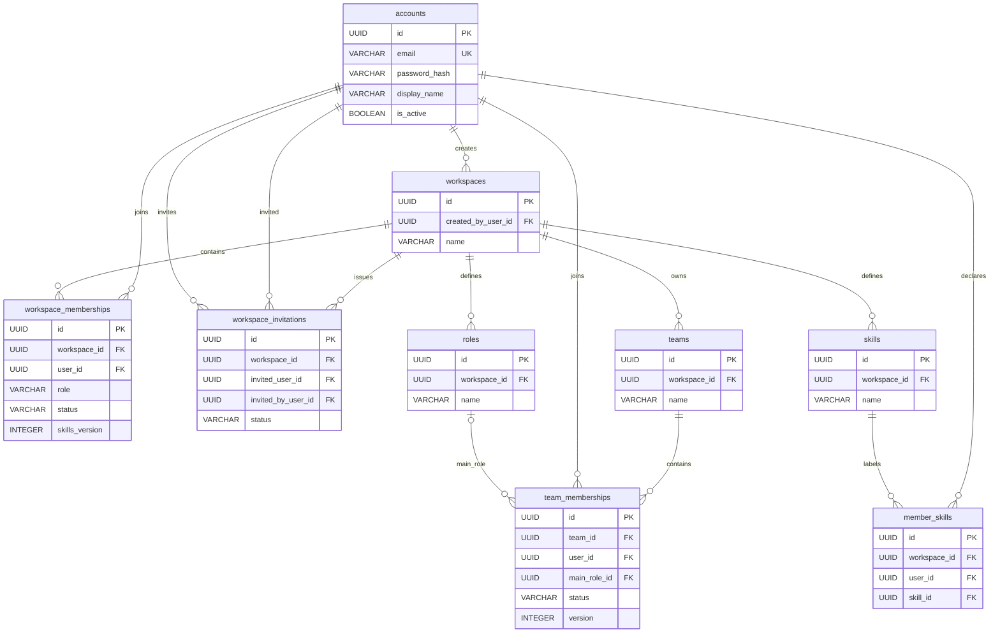
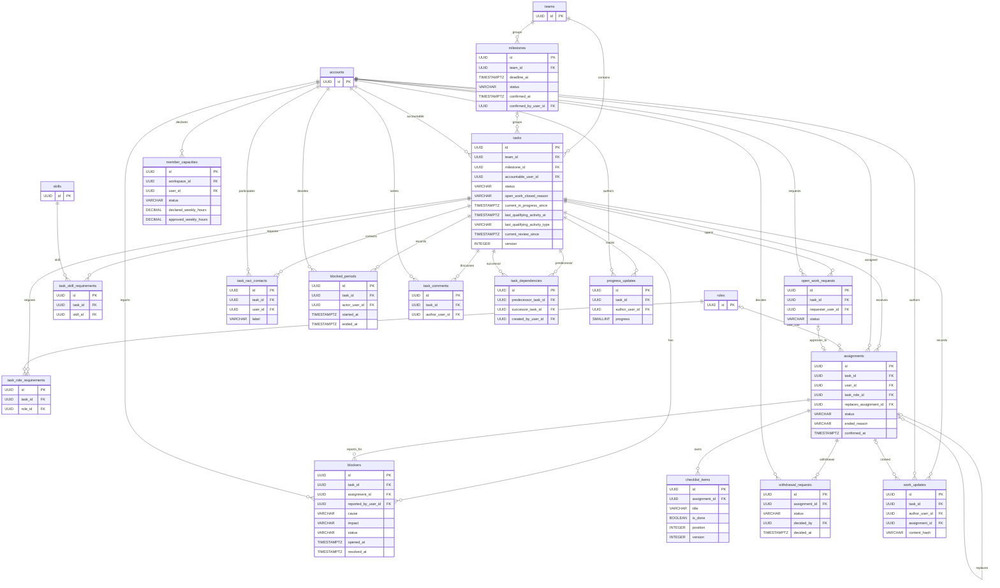
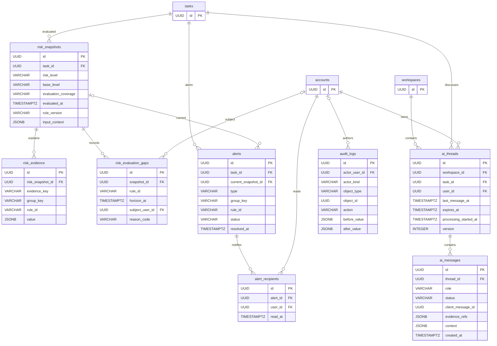

# CWRM-11 — ERD sơ bộ và từ điển dữ liệu

**Trạng thái:** 0.3.4-draft là Review Candidate lập ngày 24/11/2026 cho WP-014B/WP-015A, chờ PM duyệt; thêm cột `team_memberships.version` và `workspace_memberships.skills_version`, không thêm hay bỏ bảng. Baseline đang áp dụng vẫn là 0.3.3-draft cho tới khi PM duyệt. Bản thiết kế 0.3.3-draft cập nhật ngày 17/11/2026, không đổi bảng hay cột so với 0.3.2-draft; 0.3.2-draft cập nhật cùng ngày theo quyết định PM-03; 0.3.1-draft cập nhật cùng ngày theo review CWRM-18; nền thiết kế 0.3.0-draft lập ngày 14/11/2026 và đồng bộ theo Clarification FINAL-01..08 được PM duyệt ngày 15/11/2026. Nguồn nghiệp vụ là Scope v0.2 Final (14/11/2026) kèm Clarification FINAL-01..08 (PM duyệt 15/11/2026). Đây là kiểu PostgreSQL dự kiến; Prisma schema/migration sẽ cụ thể hóa trong CWRM-12.

## 1. Quy ước

- ERD có **33 bảng**, tên snake_case số nhiều; mọi PK UUID theo ADR-001. DB dùng snake_case; API dùng camelCase. Thời điểm dùng TIMESTAMPTZ UTC.
- Enum dùng UPPER_SNAKE_CASE. CRITICAL chỉ thuộc priority; risk_level chỉ có LOW/MEDIUM/HIGH.
- `tasks.accountable_user_id` lưu đúng một A. R được suy ra từ `assignments` có status ACCEPTED và chưa kết thúc. `task_raci_contacts` chỉ lưu C/I.
- Main Role nằm ở `team_memberships.main_role_id`; Task Role nằm ở assignment. `member_skills` lưu các skill do chính Member khai. Bảng `MemberRole` đã dựng ở CWRM-12 phải đổi trong ticket triển khai; lần cập nhật này không sửa mã.
- READY của milestone, `doneTaskCount`, `totalTaskCount`, `openWork.state`, slot count, `openBlockerCount` và `openBlockerSince` là dữ liệu suy ra khi đọc API. Milestone chỉ lưu trạng thái xác nhận và các mốc xác nhận.
- `NN` = NOT NULL; `?` = nullable; PK/FK/UQ = khóa chính/ngoại/duy nhất. FK mặc định ON DELETE RESTRICT; task, snapshot, message và audit không bị xóa dây chuyền trong MVP.

## 2. ERD — tài khoản, workspace, team, role/skill

`team_memberships.main_role_id` phải tham chiếu Role cùng workspace; membership vẫn độc lập với Main Role. Không còn quan hệ `member_roles`.

## 3. ERD — task và phối hợp

`open_work_requests` chỉ tạo assignment khi được duyệt. Pending request không giữ slot; Direct Pending có. Pending replacement không chiếm thêm slot. Blocker gắn với assignment/R báo; việc chuyển Task sang BLOCKED do Manager thực hiện và được ghi trong `blocked_periods`.

## 4. ERD — risk, alert, AI và audit

`read_at` thuộc người nhận; `alerts.resolved_at` thuộc alert. Alert lưu theo từng task; `group_key` chỉ là khóa UI để gộp hiển thị. Không có bảng recommendation riêng; chat là cơ chế AI duy nhất. `ManagerIntervention` được dựng từ `audit_logs` với action `MANAGER_INTERVENTION`, không thêm bảng.

## 5. Từ điển dữ liệu

Mọi bảng có `id UUID PK`. Bảng nghiệp vụ có `created_at TIMESTAMPTZ NN`; bảng có sửa thường xuyên có thêm `updated_at TIMESTAMPTZ NN` và `version` khi cần optimistic locking.

### 5.1 Identity, workspace và danh mục — 9 bảng

| Bảng | Cột (kiểu; null; khóa) | Ghi chú |
|---|---|---|
| accounts | email VARCHAR(320) NN UQ; password_hash VARCHAR(255) NN; display_name VARCHAR(120) NN; is_active BOOLEAN NN; created_at, updated_at TIMESTAMPTZ NN | Email chuẩn hóa chữ thường; không lưu password rõ. |
| workspaces | name VARCHAR(160) NN; created_by_user_id UUID NN FK→accounts.id; created_at, updated_at | Người tạo thành Manager trong cùng transaction. |
| workspace_memberships | workspace_id UUID NN FK; user_id UUID NN FK; role VARCHAR(16) NN; status VARCHAR(16) NN; skills_version INTEGER NN DEFAULT 1; created_at, updated_at | UQ workspace_id,user_id; role MANAGER/MEMBER; status ACTIVE/INACTIVE. `skills_version` là version của cả tập `member_skills` của người này trong workspace (API `skillsVersion`); bắt đầu 1 kể cả khi chưa có skill, chỉ tăng khi `PUT my-skills` đổi tập thật, cùng transaction với việc ghi `member_skills`. |
| workspace_invitations | workspace_id UUID NN FK; invited_user_id UUID NN FK; invited_by_user_id UUID NN FK; status VARCHAR(16) NN; responded_at TIMESTAMPTZ ?; created_at TIMESTAMPTZ NN | Chỉ mời tài khoản đã đăng ký; PENDING/ACCEPTED/DECLINED. |
| teams | workspace_id UUID NN FK; name VARCHAR(160) NN; created_at, updated_at | UQ workspace_id, normalized name. |
| team_memberships | team_id UUID NN FK; user_id UUID NN FK; main_role_id UUID ? FK→roles.id; status VARCHAR(16) NN; version INTEGER NN DEFAULT 1; created_at, updated_at | UQ team_id,user_id; ACTIVE/INACTIVE. Main Role nullable, thuộc cùng workspace; teamMembership API trả `mainRoleId`, `mainRoleName`, `version`. `PATCH /teams/{teamId}/members/{userId}` so `expectedVersion` với `version`. |
| roles | workspace_id UUID NN FK; name VARCHAR(100) NN; description TEXT ?; created_at, updated_at | UQ workspace_id, normalized name; nhãn chuyên môn, không phải quyền. |
| skills | workspace_id UUID NN FK; name VARCHAR(100) NN; description TEXT ?; created_at, updated_at | UQ workspace_id, normalized name. |
| member_skills | workspace_id UUID NN FK; user_id UUID NN FK; skill_id UUID NN FK; created_at TIMESTAMPTZ NN | UQ workspace_id,user_id,skill_id; tập skill do chính Member khai qua `PUT /workspaces/{workspaceId}/my-skills`. |

### 5.2 Task và coordination — 16 bảng

| Bảng | Cột (kiểu; null; khóa) | Ghi chú |
|---|---|---|
| milestones | team_id UUID NN FK; name VARCHAR(160) NN; description TEXT ?; deadline_at TIMESTAMPTZ NN; confirmed_at TIMESTAMPTZ ?; confirmed_by_user_id UUID ? FK; status VARCHAR(16) NN; created_at, updated_at | API có OPEN/READY/COMPLETED; READY được suy ra khi totalTaskCount>0 và mọi task DONE. `doneTaskCount`/`totalTaskCount` là số tổng hợp. COMPLETED không tự quay lại. |
| tasks | team_id UUID NN FK; milestone_id UUID ? FK; accountable_user_id UUID NN FK; title VARCHAR(200) NN; description TEXT ?; status VARCHAR(20) NN; assignment_mode VARCHAR(16) NN; open_work_opened_at TIMESTAMPTZ ?; open_work_closed_at TIMESTAMPTZ ?; open_work_closed_reason VARCHAR(24) ?; priority VARCHAR(16) NN; deadline_at TIMESTAMPTZ NN; deadline_type VARCHAR(16) NN; effort_estimate_hours DECIMAL(8,2) ?; effort_actual_hours DECIMAL(8,2) ?; required_people INTEGER NN; progress SMALLINT NN; current_in_progress_since TIMESTAMPTZ ?; last_qualifying_activity_at TIMESTAMPTZ ?; last_qualifying_activity_type VARCHAR(32) ?; current_review_since TIMESTAMPTZ ?; started_at, completed_at TIMESTAMPTZ ?; version INTEGER NN; created_at, updated_at | Composite FK team/A; milestone cùng team. Progress 0..100; effort 0 hợp lệ, NULL là chưa khai; không suy actual từ estimate−remaining. `openWork.state`, counts và slots được suy ra; `open_work_closed_reason` là FILLED/MANAGER_CLOSED. |
| task_role_requirements | task_id UUID NN FK; role_id UUID NN FK; created_at TIMESTAMPTZ NN | UQ task_id,role_id; chỉ hiển thị mức phù hợp, không gate Apply. |
| task_skill_requirements | task_id UUID NN FK; skill_id UUID NN FK; created_at TIMESTAMPTZ NN | UQ task_id,skill_id; chỉ hiển thị mức phù hợp, không gate Apply. |
| assignments | task_id UUID NN FK; user_id UUID NN FK; assigned_by_user_id UUID NN FK; status VARCHAR(24) NN; source VARCHAR(16) NN; open_work_request_id UUID ? UQ FK; task_role_id UUID ? FK; replaces_assignment_id UUID ? FK→assignments.id; responded_at TIMESTAMPTZ ?; response_reason TEXT ?; ended_at TIMESTAMPTZ ?; ended_by_user_id UUID ? FK; ended_reason VARCHAR(32) ?; confirmed_at TIMESTAMPTZ ?; effort_estimate_hours DECIMAL(8,2) ?; remaining_effort_hours DECIMAL(8,2) ?; created_at, updated_at | R là ACCEPTED chưa kết thúc. Task Role nullable. Lý do Decline DIRECT/REPLACEMENT là tùy chọn và `response_reason` nullable; actor, server timestamp, status và audit vẫn được lưu, slot giữ chỗ được giải phóng. Replacement mới ở PENDING_ACCEPTANCE; assignment cũ hiệu lực cho tới lúc Accept atomic. Assignment cũ giữ effort/checklist/confirmation làm lịch sử. |
| open_work_requests | task_id UUID NN FK; requester_user_id UUID NN FK; status VARCHAR(16) NN; reason TEXT ?; decision_reason_code VARCHAR(32) ?; decision_reason TEXT ?; decided_by_user_id UUID ? FK; created_at TIMESTAMPTZ NN; decided_at, withdrawn_at TIMESTAMPTZ ? | PENDING/APPROVED/REJECTED/WITHDRAWN. Pending không giữ slot; tự đóng FILLED hoặc Manager đóng MANAGER_CLOSED sẽ reject Pending đồng bộ. |
| task_raci_contacts | task_id UUID NN FK; user_id UUID NN FK; label VARCHAR(1) NN; assigned_by_user_id UUID NN FK; created_at TIMESTAMPTZ NN | label chỉ C/I; UQ task_id,user_id,label; không lưu A/R. |
| blockers | task_id UUID NN FK; assignment_id UUID NN FK; reported_by_user_id UUID NN FK; cause TEXT NN; impact TEXT NN; status VARCHAR(12) NN; opened_at TIMESTAMPTZ NN; resolved_at TIMESTAMPTZ ?; resolved_by_user_id UUID ? FK; resolution_note TEXT ?; created_at TIMESTAMPTZ NN | OPEN/RESOLVED; gắn với R báo. R là chủ assignment còn hiệu lực tự resolve blocker của mình; reason tùy chọn. Theo PM-03 (17/11/2026): chỉ A hiện hành của task, là Manager ACTIVE, đóng blocker OPEN khi assignment đã kết thúc; `resolved_by_user_id` là A đó, `resolution_note` bắt buộc và có audit, để tránh blocker còn sót khiến task không đủ điều kiện gửi Review; Manager không resolve blocker của R còn hiệu lực. Mở blocker không đổi Task status. |
| blocked_periods | task_id UUID NN FK; started_at TIMESTAMPTZ NN; actor_user_id UUID NN FK; reason TEXT NN; ended_at TIMESTAMPTZ ?; ended_by_user_id UUID ? FK; end_reason TEXT ?; created_at TIMESTAMPTZ NN | Một đợt cho mỗi lần Manager đưa task sang BLOCKED và kết thúc khi Manager unblock. |
| task_comments | task_id UUID NN FK; author_user_id UUID NN FK; body TEXT NN; created_at TIMESTAMPTZ NN | Trao đổi task; comment không reset đồng hồ R13 và không đưa vào AI context. |
| task_dependencies | predecessor_task_id UUID NN FK; successor_task_id UUID NN FK; created_by_user_id UUID NN FK; created_at TIMESTAMPTZ NN | UQ predecessor,successor; Finish-to-Start; cùng workspace, khác team được phép. Service chống vòng; successor chỉ sửa khi TO_DO. |
| progress_updates | task_id UUID NN FK; author_user_id UUID NN FK; progress SMALLINT NN; note TEXT ?; created_at TIMESTAMPTZ NN | Lịch sử progress chung; không chứa effortActualHours. Trùng progress hiện tại là no-op, không tạo dòng. |
| checklist_items | assignment_id UUID NN FK; title VARCHAR(240) NN; is_done BOOLEAN NN; position INTEGER NN; version INTEGER NN; created_at, updated_at TIMESTAMPTZ NN | Checklist riêng assignment/R; không deadline/status/risk riêng; thay đổi `is_done` thật khi task IN_PROGRESS reset R13. |
| withdrawal_requests | assignment_id UUID NN FK; reason TEXT NN; status VARCHAR(16) NN; decided_by UUID ? FK; decided_at TIMESTAMPTZ ?; decision_reason TEXT ?; created_at, updated_at TIMESTAMPTZ NN | PENDING/APPROVED/REJECTED/CANCELLED; PENDING không kết thúc trách nhiệm R. |
| work_updates | task_id UUID NN FK; author_user_id UUID NN FK; assignment_id UUID ? FK; content TEXT NN; output_url TEXT ?; created_at TIMESTAMPTZ NN; content_hash VARCHAR(64) NN | Timestamp do server tạo. Nội dung trùng gần nhất của cùng tác giả trên task không được lưu. Append-only trong MVP; thành công reset R13. |
| member_capacities | workspace_id UUID NN FK; user_id UUID NN FK; declared_weekly_hours DECIMAL(8,2) NN; declared_at TIMESTAMPTZ NN; approved_weekly_hours DECIMAL(8,2) ?; approved_by_user_id UUID ? FK; approved_at TIMESTAMPTZ ?; status VARCHAR(20) NN; version INTEGER NN; created_at, updated_at | UQ workspace_id,user_id. Trạng thái lưu PENDING_APPROVAL/APPROVED; NOT_DECLARED là không có dòng. Giá trị đã duyệt tiếp tục dùng đến khi duyệt số mới. |

### 5.3 Risk, AI và audit — 8 bảng

| Bảng | Cột (kiểu; null; khóa) | Ghi chú |
|---|---|---|
| risk_snapshots | task_id UUID NN FK; risk_level, base_level VARCHAR(8) NN; evaluation_coverage VARCHAR(12) NN; evaluated_at TIMESTAMPTZ NN; rule_version VARCHAR(80) NN; triggered_rules TEXT[] NN; input_fingerprint VARCHAR(80) NN; input_context JSONB NN; trigger_source VARCHAR(12) NN; created_at TIMESTAMPTZ NN | Bất biến; LOW/MEDIUM/HIGH; coverage COMPLETE/PARTIAL; trigger EVENT/HOURLY/MANUAL; HOURLY dùng giờ server UTC, chu kỳ không quá 60 phút; rule ID khớp `^R(0[1-9]|1[0-3])$`. |
| risk_evidence | risk_snapshot_id UUID NN FK; evidence_key VARCHAR(40) NN; group_key VARCHAR(40) ?; source VARCHAR(16) NN; rule_id VARCHAR(3) ?; field VARCHAR(100) NN; value JSONB NN; unit VARCHAR(32) ?; created_at TIMESTAMPTZ NN | UQ snapshot_id,evidence_key; rule_id null hoặc R01–R13. API evidence.id ánh xạ evidence_key; `evidence.groupId` ánh xạ `group_key`, nullable và ổn định trong snapshot. |
| risk_evaluation_gaps | snapshot_id UUID NN FK; rule_id VARCHAR(3) NN; horizon_at TIMESTAMPTZ ?; subject_user_id UUID ? FK; reason_code VARCHAR(32) NN; message TEXT NN; created_at TIMESTAMPTZ NN | Bảng con cho `notEvaluated[]`; reasonCode CAPACITY_NOT_DECLARED/CAPACITY_NOT_APPROVED/CAPACITY_ZERO/REMAINING_EFFORT_MISSING. |
| alerts | task_id UUID NN FK; current_snapshot_id UUID ? FK; type VARCHAR(24) NN; group_key VARCHAR(240) NN; rule_id VARCHAR(3) ?; risk_level VARCHAR(8) ?; status VARCHAR(12) NN; opened_at TIMESTAMPTZ NN; resolved_at TIMESTAMPTZ ?; created_at, updated_at | RISK/EARLY_DEPENDENCY/MILESTONE_CONFIRMATION; alert ghi theo task; group_key chỉ phục vụ UI. Early dependency chỉ phát khi predecessor trực tiếp có risk hiện hành MEDIUM/HIGH; không phát chỉ vì chưa DONE, không chép riskLevel và độc lập R06/R07. `resolved_at` khác read_at của recipient. |
| alert_recipients | alert_id UUID NN FK; user_id UUID NN FK; recipient_labels VARCHAR(1)[] NN; read_at TIMESTAMPTZ ?; created_at TIMESTAMPTZ NN | UQ alert_id,user_id; labels A/R; `read_at` nằm ở người nhận. |
| ai_threads | workspace_id UUID NN FK; task_id UUID NN FK; user_id UUID NN FK; last_message_at TIMESTAMPTZ ?; expires_at TIMESTAMPTZ ?; processing_started_at TIMESTAMPTZ ?; version INTEGER NN; created_at, updated_at | UQ workspace_id,task_id,user_id. Một thread private cho mỗi user/task; processing_started_at khóa một lượt; hết hạn sau 90 ngày từ tin cuối. |
| ai_messages | thread_id UUID NN FK; role VARCHAR(12) NN; content TEXT NN; status VARCHAR(12) ?; error_code VARCHAR(80) ?; evidence_refs JSONB NN; suggestions JSONB NN; context JSONB ?; provider VARCHAR(120) ?; model VARCHAR(160) ?; latency_ms INTEGER ?; usage JSONB ?; client_message_id UUID NN; created_at TIMESTAMPTZ NN | USER/ASSISTANT; status SUCCESS/FAILED chỉ cho ASSISTANT; tin USER có status null, tin ASSISTANT FAILED có error_code. UQ thread_id,client_message_id,role giữ nguyên. Cùng client_message_id replay nguyên kết quả đã lưu, kể cả lỗi FAILED; retry chủ động sau FAILED dùng ID mới để gọi provider. Lượt bị từ chối 403/409 không lưu nên cùng ID được xử lý như lượt mới. Không lưu prompt thô. Giữ tối đa 50 tin/thread. |
| audit_logs | actor_user_id UUID ? FK→accounts.id; actor_kind VARCHAR(8) NN; object_type VARCHAR(40) NN; object_id UUID NN; action VARCHAR(80) NN; before_value, after_value JSONB ?; reason TEXT ?; created_at TIMESTAMPTZ NN | Append-only; USER/SYSTEM; object_id đa hình nên không FK tới một bảng cụ thể. Lưu old/new effort, role, withdrawal, replacement, capacity và quyết định Manager. |

Tổng số bảng: **9 + 16 + 8 = 33**. `AIMessage.status`, `errorCode`, `evidenceRefs`, `suggestions`, `context`, `provider`, `model`, `latencyMs` và `usage` là các trường của bảng `ai_messages`; không tồn tại `ai_recommendations`.

## 6. Ràng buộc DB và service

### Có thể đặt ở PostgreSQL

| Bảo đảm | Ràng buộc |
|---|---|
| UUID PK/FK, không xóa task/audit dây chuyền | PK/FK, ON DELETE RESTRICT. |
| Email duy nhất | Unique index `lower(email)`. |
| Membership duy nhất | UQ `workspace_id,user_id`; UQ `team_id,user_id`; UQ capacity `workspace_id,user_id`. |
| Tên team/role/skill duy nhất trong workspace | UQ `workspace_id,lower(name)`. |
| Role Main Role cùng workspace | Service kiểm tra; FK/composite key nếu schema vật lý biểu diễn workspace_id trên role membership. |
| Một request Pending/task/user | Partial unique `open_work_requests(task_id,requester_user_id) WHERE status='PENDING'`. |
| Một R Accepted hiệu lực/task/user | Partial unique `assignments(task_id,user_id) WHERE status='ACCEPTED' AND ended_at IS NULL`. |
| Không có Direct Pending trùng/task/user | Partial unique `assignments(task_id,user_id) WHERE status='PENDING_ACCEPTANCE' AND source='DIRECT' AND ended_at IS NULL`. |
| Request Open Work tạo tối đa một assignment | Unique nullable `assignments.open_work_request_id`. |
| Mỗi assignment tối đa một replacement đang chờ | Partial unique `assignments.replaces_assignment_id WHERE status='PENDING_ACCEPTANCE' AND ended_at IS NULL`; vi phạm trả 409 `UNIQUE_CONFLICT`. |
| Milestone/task cùng team | Composite FK qua `tasks(team_id,milestone_id)` và `milestones(team_id,id)`; create/update sai quan hệ trả 422 `MILESTONE_TEAM_MISMATCH`. |
| Dependency khác workspace bị loại | Service kiểm tra cùng workspace; composite FK có thể dùng workspace_id trên cạnh nếu cần ràng buộc DB. Khác Team được phép. |
| Không lặp requirement/contact/dependency/evidence/recipient/checklist position | Unique indexes theo cặp được nêu trong từ điển; checklist có unique `(assignment_id,position)` nếu position phải duy nhất. |
| Một thread cho mỗi workspace/task/user | UQ `ai_threads(workspace_id,task_id,user_id)`. |
| Idempotency message trong thread | UQ `ai_messages(thread_id,client_message_id,role)`. |
| Miền đơn cột | CHECK progress 0..100; effort/capacity ≥0; required_people≥1; enum hợp lệ; version≥1; hai task dependency khác nhau. |

### Bắt buộc ở service/transaction

| Quy tắc | Lý do |
|---|---|
| A là Manager workspace, thành viên team ACTIVE; không xóa, hạ quyền hoặc vô hiệu hóa Manager cuối | Kết hợp membership, quyền và trạng thái task; thao tác cuối cùng trả 422 `LAST_MANAGER_REQUIRED`. |
| Skill do chính Member khai; Main Role do Manager đặt theo team; Task Role theo assignment | Phân biệt ba phạm vi nhãn; Main Role không còn ở workspace membership. |
| Direct Pending chiếm slot; occupiedSlots = Accepted còn hiệu lực + Direct Pending thường | Đếm đồng thời dưới khóa task; Open Work Pending và replacement Pending không tính. |
| Không vượt required_people khi đổi số người hoặc Accept/Approve | Đếm và khóa hàng task; lỗi 409 `CAPACITY_EXCEEDED`. |
| Atomic replacement | Trong một transaction khi người mới Accept: kết thúc assignment cũ với `endedReason=REPLACED`, kích hoạt assignment mới; sau commit số R Accepted không vượt requiredPeople. Decline/hủy giữ R cũ. Hai thao tác tranh nhau trả 409 `VERSION_CONFLICT` hoặc `CAPACITY_EXCEEDED`. |
| Thêm/thay/duyệt rút R chỉ khi task TO_DO/IN_PROGRESS/BLOCKED | Ở REVIEW trả 422 `ASSIGNMENT_CHANGE_NOT_ALLOWED_IN_REVIEW`; DONE chỉ đọc. Duyệt rút R cuối nếu chưa có R Accepted khác trả 422 `RESPONSIBILITY_REQUIRED`. |
| Duyệt Open Work và tự đóng | Trong transaction khóa task, kiểm tra status/capacity, tạo assignment ACCEPTED, cập nhật request. Chỉ khi acceptedCount==requiredPeople mới đặt FILLED và reject các request Pending còn lại với `decisionReasonCode=FILLED`; Manager close dùng MANAGER_CLOSED. Không mở lại tự động sau đóng chính thức. |
| Start và cập nhật progress | Manager ACTIVE trong workspace chứa task hoặc R Accepted còn hiệu lực; Start cần A hợp lệ, ít nhất một R Accepted và mọi predecessor trực tiếp DONE. Progress chỉ ở IN_PROGRESS/BLOCKED. Ghi expectedVersion, actor, server timestamp và audit; progress đổi thực do Manager cũng là `PROGRESS_CHANGED` cho R13, no-op không reset. |
| Decline Direct/Replacement | Lý do tùy chọn, nếu có không rỗng; luôn lưu actor, server timestamp, status và audit, đồng thời giải phóng slot giữ chỗ. |
| Resolve blocker | R là chủ assignment còn hiệu lực chỉ resolve blocker của mình. PM-03: chỉ người là Manager ACTIVE và A hiện hành của task resolve blocker OPEN gắn assignment đã kết thúc, reason bắt buộc và audit; Manager khác không phải A, hoặc Manager resolve blocker của R còn hiệu lực, trả 403 `FORBIDDEN`. Resolve blocker cuối không tự unblock task. |
| Review/Return | Review cần progress=100, mọi R Accepted hiệu lực confirmed, không blocker OPEN. Return chọn ít nhất một R hiệu lực; chỉ reset confirmation của các R được chọn. |
| Tổng effort phân bổ | Khi Task estimate khác NULL, tổng estimate của R còn hiệu lực không vượt estimate Task; transaction trả 422 `EFFORT_ALLOCATION_EXCEEDED`. NULL không kiểm. |
| Capacity/R09 | Capacity Manager duyệt mới được dùng. Khi approved capacity hoặc remaining effort của R đổi, reevaluate toàn bộ task liên quan của R trong workspace. |
| Một lượt AI mỗi thread | Khóa `ai_threads.processing_started_at` trong transaction; gửi khi đang xử lý trả 409 `AI_TURN_IN_PROGRESS`. Kiểm quyền và version context trước/sau gọi provider; context đổi trả 409 `AI_CONTEXT_CHANGED`, mất quyền trả 403. |
| Early dependency alert | Chỉ cảnh báo successor trực tiếp khi predecessor có risk snapshot hiện hành MEDIUM/HIGH; chưa DONE đơn thuần không đủ, không sao chép riskLevel; độc lập với R06/R07. |
| ACL và giới hạn predecessor | Member ngoài team predecessor chỉ nhận metadata trong `Task.predecessors`; gọi trực tiếp task/checklist/comment/work-update/AI thread predecessor trả 404 `NOT_FOUND`. |
| Audit | Ghi before/after, actor, UTC timestamp và reason theo quy tắc endpoint; chỉ append. |

### Quy ước mã lỗi liên quan

Review Candidate 0.3.4-draft đề xuất thêm `FILTER_NOT_AVAILABLE` (422, đề xuất P-02, chỉ ở API, không có bảng). Các mã dùng trong contract 0.3.3-draft gồm: `VALIDATION_ERROR`, `UNAUTHENTICATED`, `FORBIDDEN`, `NOT_FOUND`, `VERSION_CONFLICT`, `CAPACITY_EXCEEDED`, `UNIQUE_CONFLICT`, `INVALID_STATE_TRANSITION`, `OPEN_WORK_TEMPORARILY_FULL`, `OPEN_WORK_CLOSED`, `PREDECESSOR_NOT_DONE`, `OPEN_BLOCKERS_EXIST`, `NO_ACCEPTED_RESPONSIBLE`, `DEPENDENCY_CYCLE`, `CROSS_WORKSPACE_DEPENDENCY`, `MILESTONE_TEAM_MISMATCH`, `ACCOUNTABLE_NOT_MANAGER`, `LAST_MANAGER_REQUIRED`, `RESPONSIBILITY_REQUIRED`, `INVITEE_NOT_REGISTERED`, `ASSIGNMENT_CHANGE_NOT_ALLOWED_IN_REVIEW`, `PROGRESS_NOT_COMPLETE`, `RESPONSIBLE_CONFIRMATION_MISSING`, `EFFORT_ALLOCATION_EXCEEDED`, `WORK_UPDATE_DUPLICATE`, `RISK_INPUT_INVALID`, `RISK_EVALUATION_FAILED`, `AI_CONTEXT_UNAVAILABLE`, `AI_CONTEXT_CHANGED`, `AI_TURN_IN_PROGRESS`, `AI_PROVIDER_ERROR`, `AI_OUTPUT_INVALID`, `AI_TIMEOUT`, `AI_QUOTA_EXCEEDED`, `SERVICE_UNAVAILABLE`, `INTERNAL_ERROR`. Danh sách đầy đủ và status nằm tại `openapi.yaml`.

## 7. Chỉ mục tra cứu dự kiến

- `workspace_memberships(user_id,workspace_id,status)`; `team_memberships(user_id,team_id,status)`; `team_memberships(team_id,main_role_id)`.
- `tasks(team_id,status,deadline_at)`; `tasks(milestone_id,status)`; `tasks(accountable_user_id,status)`; index partial cho task chưa DONE.
- `assignments(user_id,status,ended_at)`; `assignments(task_id,status,ended_at)`; partial unique cho R hiệu lực, Direct Pending và replacement chờ.
- `open_work_requests(task_id,status,created_at)`; unique partial cho request Pending của cùng người.
- `checklist_items(assignment_id,position)`; `withdrawal_requests(status,created_at)`; index tìm request PENDING theo task/assignment.
- `blockers(task_id,status,opened_at)`; partial index blocker OPEN; `blocked_periods(task_id,started_at,ended_at)`.
- `work_updates(task_id,author_user_id,created_at DESC)`; index `(task_id,author_user_id,content_hash,created_at DESC)` cho kiểm trùng nội dung gần nhất.
- `member_capacities(workspace_id,status,user_id)`; unique workspace/user.
- `task_dependencies(predecessor_task_id)` và `(successor_task_id)`; `risk_snapshots(task_id,evaluated_at DESC)`; `risk_evaluation_gaps(snapshot_id,rule_id,horizon_at,subject_user_id)`.
- `alerts(task_id,status)`; `alerts(group_key,status)`; `alert_recipients(user_id,read_at)`.
- `ai_threads(workspace_id,task_id,user_id)` unique; `ai_threads(expires_at)` cho job dọn; `ai_messages(thread_id,created_at)` và unique idempotency.
- `audit_logs(object_type,object_id,created_at DESC)`; `audit_logs(actor_user_id,created_at DESC)`.

## 8. Truy vết S01–S12 → bảng và API

| Scope | Bảng chính | Liên quan | API chính |
|---|---|---|---|
| S01 Tài khoản/workspace/membership/invite | accounts, workspaces, workspace_memberships, workspace_invitations | audit_logs | Auth, Workspace |
| S02 Team/Role/Skill | teams, team_memberships, roles, skills, member_skills | workspace_memberships, audit_logs | Team; `PUT /workspaces/{workspaceId}/my-skills`; `PATCH /teams/{teamId}/members/{userId}` |
| S03 Task/checklist/milestone | tasks, milestones, assignments, checklist_items | audit_logs | Task; `GET /tasks/{taskId}/checklists`; checklist item endpoints; milestone confirm |
| S04 Direct/withdrawal/replacement | assignments, withdrawal_requests | tasks, audit_logs | direct-assignments; withdrawal-requests; replacements; manager-end |
| S05 Open Work | open_work_requests, assignments, tasks | task role/skill requirements chỉ để hiển thị fit | eligibility, open-work requests/open/close/approve/reject |
| S06 RACI/confirmation/Review | tasks, assignments, task_raci_contacts | checklist_items, audit_logs | confirm/unconfirm; submit-review; return |
| S07 Status/progress/effort/capacity | tasks, progress_updates, assignments, member_capacities | audit_logs | progress-updates; management-interventions; effort endpoints; my-capacity/capacities |
| S08 Blocker/comment/Work Update | blockers, blocked_periods, task_comments, work_updates | tasks, assignments, audit_logs | blockers/resolve; block/unblock; comments; work-updates |
| S09 Finish-to-Start dependency | task_dependencies | tasks, teams, alerts | dependencies; metadata predecessors/successors trong Task |
| S10 Risk/evidence/coverage | risk_snapshots, risk_evidence, risk_evaluation_gaps | tasks, assignments, blockers, dependencies, milestones, member_capacities | risk-rules; risk-snapshots |
| S11 Dashboard/alert | alerts, alert_recipients | snapshots, gaps, tasks, milestones, withdrawal_requests, member_capacities | dashboard/manager; dashboard/my-work; alerts |
| S12 AI chat | ai_threads, ai_messages | tasks, risk_snapshots, risk_evidence, work_updates, audit_logs | ai-thread GET/POST/DELETE |

## 9. Câu hỏi mở

Quyết định PM-03 (17/11/2026): chỉ A hiện hành của task, là Manager ACTIVE, đóng blocker OPEN khi assignment gắn với blocker đã kết thúc, với reason và audit để task không bị blocker còn sót chặn gửi Review. Quyết định không đổi cột hay bảng; chi tiết ghi trong Review Log. Các chi tiết physical schema như chuẩn hóa JSON fingerprint và migration MemberRole được xử lý trong ticket triển khai; chúng không thay đổi contract.

## Nguồn

Scope v0.2 Final (14/11/2026) kèm Clarification FINAL-01..08 (PM duyệt 15/11/2026), đặc biệt S01–S12, R01–R13, §6 và AC01–AC14; ADR-001. Bản ERD logical không thay thế migration Prisma của CWRM-12.
