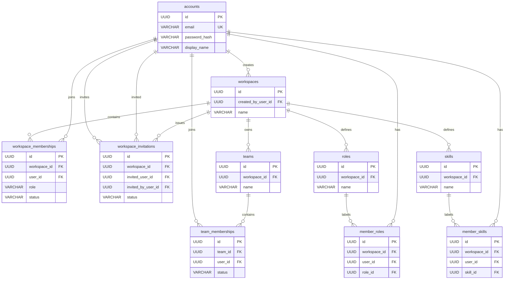
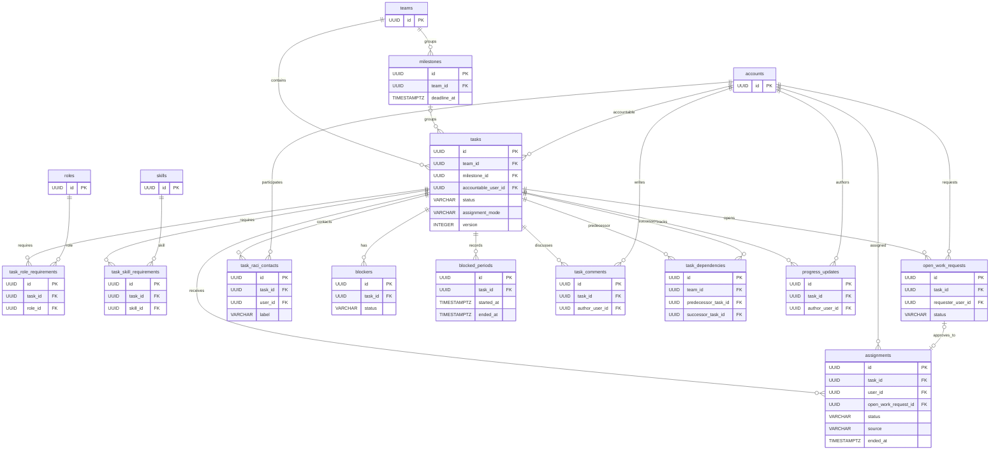
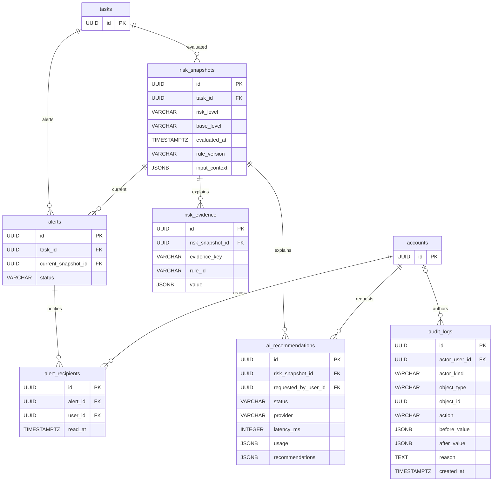

# CWRM-11 — ERD sơ bộ và từ điển dữ liệu

**Trạng thái:** bản thiết kế cập nhật cùng contract 0.2.0-draft ngày 12/11/2026. Nguồn nghiệp vụ là Project Scope v0.1. Đây là kiểu PostgreSQL dự kiến; Prisma schema/migration sẽ cụ thể hóa trong CWRM-12.

## 1. Quy ước

- ERD gồm **28 bảng**, tên snake_case số nhiều, mọi PK UUID theo ADR-001. DB dùng snake_case; API dùng camelCase. Thời điểm là TIMESTAMPTZ UTC.
- UPPER_SNAKE_CASE cho enum. CRITICAL chỉ thuộc priority; risk_level theo Scope chỉ LOW/MEDIUM/HIGH.
- tasks.accountable_user_id NOT NULL lưu đúng một A. R không có bảng riêng: là assignments có status ACCEPTED và ended_at IS NULL. task_raci_contacts chỉ lưu C/I.
- NN = NOT NULL; ? = nullable; PK/FK/UQ = khóa chính/ngoại/duy nhất. FK mặc định ON DELETE RESTRICT; task/audit không bị xóa trong MVP.

## 2. ERD — tài khoản, workspace, team, role/skill

## 3. ERD — task và phối hợp

Open Work request Approved có tối đa một assignment; Direct Assignment không liên kết request.

## 4. ERD — risk, AI, audit

Response `ManagerIntervention` không cần bảng riêng: bản ghi lấy từ `audit_logs` với `action=MANAGER_INTERVENTION`; `audit_logs.id` là `intervention.id`, `object_id` là `taskId`, `actor_user_id` là người thực hiện, `reason` và `created_at` được trả trực tiếp. `before_value.progress`/`after_value.progress` map tới `progressBefore`/`progressAfter`; `before_value.effortActualHours`/`after_value.effortActualHours` map tới các trường effort tương ứng. Không thêm cột cho dữ liệu hiển thị được suy ra khi trả API.

## 5. Từ điển dữ liệu

Mọi bảng có id UUID PK. Các bảng nghiệp vụ có created_at TIMESTAMPTZ NN; nếu cần sửa thường xuyên có updated_at TIMESTAMPTZ NN.

### 5.1 Identity, workspace và danh mục — 10 bảng

| Bảng | Cột (kiểu; null; khóa) | Ghi chú |
|---|---|---|
| accounts | email VARCHAR(320) NN UQ; password_hash VARCHAR(255) NN; display_name VARCHAR(120) NN; is_active BOOLEAN NN; created_at, updated_at TIMESTAMPTZ NN | Email chuẩn hóa chữ thường; không lưu password rõ. |
| workspaces | name VARCHAR(160) NN; created_by_user_id UUID NN FK→accounts.id; created_at, updated_at | Người tạo thành Manager trong cùng transaction. |
| workspace_memberships | workspace_id UUID NN FK; user_id UUID NN FK; role VARCHAR(16) NN; status VARCHAR(16) NN; created_at, updated_at | UQ workspace_id,user_id; role MANAGER/MEMBER; status ACTIVE/INACTIVE. |
| workspace_invitations | workspace_id UUID NN FK; invited_user_id UUID NN FK→accounts; invited_by_user_id UUID NN FK→accounts; status VARCHAR(16) NN; responded_at TIMESTAMPTZ ?; created_at TIMESTAMPTZ NN | Chỉ mời tài khoản đã đăng ký, không gửi email; PENDING/ACCEPTED/DECLINED. |
| teams | workspace_id UUID NN FK; name VARCHAR(160) NN; created_at, updated_at | UQ workspace_id, normalized name. |
| team_memberships | team_id UUID NN FK; user_id UUID NN FK; status VARCHAR(16) NN; created_at, updated_at | UQ team_id,user_id; ACTIVE/INACTIVE; unique pair làm đích composite FK cho A thuộc team. |
| roles | workspace_id UUID NN FK; name VARCHAR(100) NN; description TEXT ?; created_at, updated_at | UQ workspace_id, normalized name; nhãn chuyên môn, không phải quyền. |
| skills | workspace_id UUID NN FK; name VARCHAR(100) NN; description TEXT ?; created_at, updated_at | UQ workspace_id, normalized name. |
| member_roles | workspace_id UUID NN FK; user_id UUID NN FK; role_id UUID NN FK; created_at TIMESTAMPTZ NN | UQ workspace_id,user_id,role_id; service xác nhận cùng workspace. |
| member_skills | workspace_id UUID NN FK; user_id UUID NN FK; skill_id UUID NN FK; created_at TIMESTAMPTZ NN | UQ workspace_id,user_id,skill_id; service xác nhận cùng workspace. |

### 5.2 Task và coordination — 12 bảng

| Bảng | Cột (kiểu; null; khóa) | Ghi chú |
|---|---|---|
| milestones | team_id UUID NN FK; name VARCHAR(160) NN; description TEXT ?; deadline_at TIMESTAMPTZ NN; created_at, updated_at | Thuộc một team; task gắn tối đa một milestone. |
| tasks | team_id UUID NN FK; milestone_id UUID ? FK; accountable_user_id UUID NN FK→accounts; title VARCHAR(200) NN; description TEXT ?; status VARCHAR(20) NN; assignment_mode VARCHAR(16) NN; open_work_open BOOLEAN NN; priority VARCHAR(16) NN; deadline_at TIMESTAMPTZ NN; deadline_type VARCHAR(16) NN; effort_estimate_hours DECIMAL(8,2) ?; effort_actual_hours DECIMAL(8,2) ?; required_people INTEGER NN; progress SMALLINT NN; result_text TEXT ?; result_url TEXT ?; started_at, completed_at TIMESTAMPTZ ?; version INTEGER NN; created_at, updated_at | Composite FK (team_id,accountable_user_id)→team_memberships(team_id,user_id); service xác nhận membership ACTIVE và role MANAGER. Composite FK (team_id,milestone_id)→milestones(team_id,id) bảo đảm milestone cùng team. Check enum, required_people≥1, progress 0..100, version≥1. Task mới TO_DO/0%; đổi status chỉ qua action endpoint. |
| task_role_requirements | task_id UUID NN FK; role_id UUID NN FK; created_at TIMESTAMPTZ NN | UQ task_id,role_id; nhiều role; khớp ít nhất một nếu có yêu cầu. |
| task_skill_requirements | task_id UUID NN FK; skill_id UUID NN FK; created_at TIMESTAMPTZ NN | UQ task_id,skill_id; nhiều skill; phải đủ tất cả nếu có yêu cầu. |
| assignments | task_id UUID NN FK; user_id UUID NN FK; assigned_by_user_id UUID NN FK; status VARCHAR(24) NN; source VARCHAR(16) NN; open_work_request_id UUID ? UQ FK; responded_at TIMESTAMPTZ ?; response_reason TEXT ?; ended_at TIMESTAMPTZ ?; ended_by_user_id UUID ? FK; end_reason TEXT ?; created_at TIMESTAMPTZ NN | Status đúng PENDING_ACCEPTANCE/ACCEPTED/DECLINED; source DIRECT/OPEN_WORK. Manager-end dùng ended_*, không giả thành Declined. |
| open_work_requests | task_id UUID NN FK; requester_user_id UUID NN FK; status VARCHAR(16) NN; reason TEXT ?; decision_reason TEXT ?; decided_by_user_id UUID ? FK; created_at TIMESTAMPTZ NN; decided_at, withdrawn_at TIMESTAMPTZ ? | Status đúng PENDING/APPROVED/REJECTED/WITHDRAWN. Chỉ Approved tạo assignment Accepted. |
| task_raci_contacts | task_id UUID NN FK; user_id UUID NN FK; label VARCHAR(1) NN; assigned_by_user_id UUID NN FK; created_at TIMESTAMPTZ NN | label chỉ C/I; UQ task_id,user_id,label; không lưu A/R. |
| blockers | task_id UUID NN FK; created_by_user_id UUID NN FK; description TEXT NN; status VARCHAR(12) NN; opened_at TIMESTAMPTZ NN; resolved_by_user_id UUID ? FK; resolved_at TIMESTAMPTZ ?; resolution_note TEXT ?; created_at TIMESTAMPTZ NN | Status OPEN/RESOLVED; task có nhiều blocker. |
| blocked_periods | task_id UUID NN FK; started_at TIMESTAMPTZ NN; ended_at TIMESTAMPTZ ?; created_at TIMESTAMPTZ NN | Một đợt mỗi lần Blocked; partial unique một ended_at IS NULL/task. |
| task_comments | task_id UUID NN FK; author_user_id UUID NN FK; body TEXT NN; created_at TIMESTAMPTZ NN | Trao đổi lưu lịch sử; không realtime. |
| task_dependencies | team_id UUID NN FK; predecessor_task_id UUID NN FK→tasks; successor_task_id UUID NN FK→tasks; created_by_user_id UUID NN FK; created_at TIMESTAMPTZ NN | UQ predecessor,successor; check không tự phụ thuộc. Hai composite FK (team_id,predecessor_task_id) và (team_id,successor_task_id)→tasks(team_id,id) bảo đảm hai task cùng team ngay ở DB. Không vòng do service; Finish-to-Start. |
| progress_updates | task_id UUID NN FK; author_user_id UUID NN FK; progress SMALLINT ?; effort_actual_hours DECIMAL(8,2) ?; result_text TEXT ?; result_url TEXT ?; note TEXT ?; created_at TIMESTAMPTZ NN | Lịch sử task-level, không timesheet; ít nhất một giá trị cập nhật; progress 0..100. |

### 5.3 Risk, AI và audit — 6 bảng

| Bảng | Cột (kiểu; null; khóa) | Ghi chú |
|---|---|---|
| risk_snapshots | task_id UUID NN FK; risk_level, base_level VARCHAR(8) NN; evaluated_at TIMESTAMPTZ NN; rule_version VARCHAR(80) NN; triggered_rules TEXT[] NN; input_fingerprint VARCHAR(80) NN; input_context JSONB NN; trigger_source VARCHAR(12) NN; created_at TIMESTAMPTZ NN | Bất biến; LOW/MEDIUM/HIGH; source EVENT/HOURLY/MANUAL; rule IDs khớp ^R(0[1-9]|1[0-2])$. Low hợp lệ có arrays rỗng. |
| risk_evidence | risk_snapshot_id UUID NN FK; evidence_key VARCHAR(40) NN; source VARCHAR(16) NN; rule_id VARCHAR(3) ?; field VARCHAR(100) NN; value JSONB NN; unit VARCHAR(32) ?; created_at TIMESTAMPTZ NN | UQ snapshot_id,evidence_key; rule_id null hoặc R01–R12; JSONB chứa scalar evidence. API evidence.id ánh xạ tới evidence_key, ổn định trong snapshot. |
| alerts | task_id UUID NN FK; current_snapshot_id UUID NN FK→risk_snapshots; risk_level VARCHAR(8) NN; status VARCHAR(12) NN; opened_at TIMESTAMPTZ NN; resolved_at TIMESTAMPTZ ?; created_at, updated_at | OPEN/RESOLVED; partial unique một OPEN/task. Cập nhật snapshot/evidence, không nhân bản. |
| alert_recipients | alert_id UUID NN FK; user_id UUID NN FK; recipient_labels VARCHAR(1)[] NN; read_at TIMESTAMPTZ ?; created_at TIMESTAMPTZ NN | UQ alert_id,user_id; labels chứa A, R hoặc cả hai nếu một người đồng thời giữ hai nhãn; read khác resolve. |
| ai_recommendations | risk_snapshot_id UUID NN FK; requested_by_user_id UUID NN FK; status VARCHAR(12) NN; provider VARCHAR(80) ?; model VARCHAR(120) ?; summary TEXT ?; linked_evidence_ids JSONB ?; recommendations JSONB ?; error_code VARCHAR(80) ?; error_message TEXT ?; input_fingerprint VARCHAR(80) NN; latency_ms INTEGER ?; usage JSONB ?; created_at TIMESTAMPTZ NN | SUCCESS/FAILED; success có 2–3 phương án. `latency_ms` và `usage` là telemetry tùy chọn/null; usage chứa inputTokens/outputTokens nếu provider trả về. Provider không khóa cứng; không lưu prompt thô. |
| audit_logs | actor_user_id UUID ? FK→accounts; actor_kind VARCHAR(8) NN; object_type VARCHAR(40) NN; object_id UUID NN; action VARCHAR(80) NN; before_value, after_value JSONB ?; reason TEXT ?; created_at TIMESTAMPTZ NN | Append-only; actor_kind USER/SYSTEM; object_id đa hình nên không FK tới một bảng cụ thể. Can thiệp Manager dùng action `MANAGER_INTERVENTION`; API dựng intervention từ audit record, không tạo bảng trùng chức năng. |

## 6. Ràng buộc DB và service

### Có thể đặt ở PostgreSQL

| Bảo đảm | Ràng buộc |
|---|---|
| UUID PK/FK, không xóa task/audit dây chuyền | PK/FK, ON DELETE RESTRICT |
| Email duy nhất | unique index lower(email) |
| Membership duy nhất | UQ workspace_id,user_id; UQ team_id,user_id |
| Tên team/role/skill duy nhất trong workspace | UQ workspace_id,lower(name) |
| Tối đa một request Pending/task/user | partial unique open_work_requests(task_id,requester_user_id) WHERE status='PENDING' |
| Tối đa một R Accepted hiệu lực/task/user | partial unique assignments(task_id,user_id) WHERE status='ACCEPTED' AND ended_at IS NULL |
| Không có direct pending trùng/task/user | partial unique assignments(task_id,user_id) WHERE status='PENDING_ACCEPTANCE' AND source='DIRECT' AND ended_at IS NULL |
| Request tạo tối đa một assignment | unique nullable assignments.open_work_request_id |
| Tối đa một alert OPEN/task | partial unique alerts(task_id) WHERE status='OPEN' |
| Tối đa một blocked period mở/task | partial unique blocked_periods(task_id) WHERE ended_at IS NULL |
| Không lặp requirement/contact/dependency/evidence/recipient | unique indexes theo các cặp nêu trong từ điển |
| Dependency và milestone cùng team với task | composite FK qua unique tasks(team_id,id) và unique milestones(team_id,id) |
| Miền đơn cột | CHECK progress 0..100, effort≥0, required_people≥1, enum hợp lệ, hai task dependency khác nhau, version≥1 |

### Bắt buộc ở service/transaction

| Quy tắc | Lý do |
|---|---|
| A là Manager workspace, thành viên team ACTIVE; không gỡ Manager cuối hoặc A/R cần thiết | Kết hợp role, membership và trạng thái task; FK composite không chứng minh role hay ACTIVE. |
| R chỉ Accepted hiệu lực; Pending request không tạo R; Approved sinh Accepted; quản lý kết thúc không thành Declined | Đồng bộ trạng thái và lịch sử qua nhiều bảng. |
| Không vượt required_people: đếm Accepted hiệu lực + Direct Pending hiệu lực; không giảm capacity thấp hơn số chỗ đang giữ | Đếm đồng thời; khóa hàng task trong transaction. |
| Eligibility lúc request/approve; task Open Work mở và To Do | Phụ thuộc team, role/skill, yêu cầu task và trạng thái tại thời điểm thao tác. Role: ít nhất một; skill: tất cả. |
| Không request khi là R; trạng thái chuyển đúng S07; blocker mở chặn Review/Done; Blocked thoát khi không còn blocker; 100% không tự Done | Nhiều hàng và actor A/R; dùng action endpoint/state machine. |
| Dependency không vòng; chỉ sửa khi task phụ thuộc còn TO_DO; Start bị chặn trước khi predecessor Done | Chu trình cần graph check và serialize cập nhật để chống race. |
| Chuyển A sang Manager cùng team; kiểm version | Cập nhật membership/task đồng thời; optimistic locking và 409 VERSION_CONFLICT. |
| Risk snapshot bất biến; recipient là A/R hiệu lực; AI chỉ Manager trên Medium/High và snapshot hiện hành | Cần quyền và so fingerprint dữ liệu hiện tại. |
| Audit đúng before/after/reason, chỉ append | Ghi cùng transaction; hạn chế UPDATE/DELETE ở quyền ứng dụng/DB. |

Khóa task trước capacity check và tăng tasks.version khi ghi; xung đột chỗ trả 409 CAPACITY_EXCEEDED. Ràng buộc vòng dependency cần khóa/serialization nhất quán.

## 7. Chỉ mục tra cứu dự kiến

- tasks(team_id,status,deadline_at), tasks(accountable_user_id,status), tasks(milestone_id); unique tasks(team_id,id) và unique milestones(team_id,id) làm đích cho composite FK.
- assignments(task_id,status,ended_at), assignments(user_id,status,ended_at); open_work_requests(task_id,status,created_at).
- task_dependencies(predecessor_task_id), task_dependencies(successor_task_id); blockers(task_id,status); blocked_periods(task_id,started_at).
- risk_snapshots(task_id,evaluated_at DESC); unique (task_id,input_fingerprint,rule_version) chỉ cân nhắc nếu Ban xác nhận có thể tái sử dụng snapshot.
- alerts(status,opened_at DESC), alert_recipients(user_id,read_at).
- audit_logs(object_type,object_id,created_at DESC), audit_logs(actor_user_id,created_at DESC).

Đây là chỉ mục dự kiến, không phải số đo hiệu năng.

## 8. Truy vết S01–S12 → bảng và API

Cột cuối là tag chứa các operation tương ứng trong [openapi.yaml](../api/openapi.yaml).

| Scope | Bảng chính | Liên quan | Tag API |
|---|---|---|---|
| S01 Tài khoản/workspace/membership/invite | accounts, workspaces, workspace_memberships, workspace_invitations | audit_logs | Auth, Workspace |
| S02 Team/Role/Skill | teams, team_memberships, roles, skills, member_roles, member_skills | workspace_memberships, audit_logs | Team |
| S03 Task/milestone | tasks, milestones | task_role_requirements, task_skill_requirements, audit_logs | Task |
| S04 Direct Assignment | assignments | tasks, audit_logs | Assignment |
| S05 Open Work request | open_work_requests, assignments | role/skill requirements, member_roles/member_skills, team_memberships | Assignment |
| S06 RACI/Review | tasks, assignments, task_raci_contacts | A trên task, R suy ra, audit_logs | RACI; Task (approve, return) |
| S07 Status/progress/effort/result | tasks, progress_updates | audit_logs | Task (start, submit-review); Progress |
| S08 Blocker/comment/đợt Blocked | blockers, blocked_periods, task_comments | tasks, progress_updates, audit_logs | Progress |
| S09 Finish-to-Start dependency | task_dependencies | tasks | Task (dependencies) |
| S10 Risk/evidence | risk_snapshots, risk_evidence | tasks, assignments, blockers, blocked_periods, dependencies, milestones | Risk |
| S11 Dashboard/alert/lịch sử | risk_snapshots, risk_evidence, alerts, alert_recipients, audit_logs | tasks, teams, assignments | Dashboard, Audit |
| S12 AI/recommendation/Manager action | ai_recommendations, risk_snapshots, risk_evidence | audit_logs và bảng nghiệp vụ bị thay đổi | AI; hành động của Manager dùng các tag nghiệp vụ ở trên |

## 9. Câu hỏi mở

1. Khi triển khai fingerprint, chốt quy tắc null/thiếu, thứ tự cụ thể của từng mảng và fixture có digest cố định như ghi ở Architecture mục 4.
2. CWRM-15/backend chốt các giá trị cụ thể của `ruleVersion`; cấu hình được version hóa, input thiếu/sai miền trả `RISK_INPUT_INVALID` và không tạo snapshot theo phản hồi B-05.
3. Khi A/R đổi trong alert OPEN, service cập nhật danh sách recipient; cần xác nhận cách giữ read_at của người vẫn nhận.
4. CWRM-12 cần kiểm tra composite FK, CHECK và partial unique index với phiên bản Prisma được dùng; ràng buộc nào không khai báo được trong Prisma schema thì viết trong SQL migration.
5. member_roles/member_skills hiện để service kiểm tra role, skill và thành viên cùng workspace. Có thể chuyển thành composite FK tới workspace_memberships(workspace_id,user_id) và roles/skills(workspace_id,id) nếu CWRM-12 thấy đáng.

## Nguồn

Project Scope v0.1 mục 6.1–6.3, S01–S12, 9–10; Foundation mục 3, 4, 6; D1–D5; CWRM-15 risk schema ứng viên (R01–R03, không giới hạn contract R01–R12).
