# CWRM-13 — User flow và wireframe MVP

**Nguồn thiết kế đang dùng:** [FigJam “User flow” — 4 luồng](https://www.figma.com/board/AYGbljSDqFh9YbnGQ5sU8h/User-flow?node-id=0-1) và [Figma Design — 8 màn SC-00 đến SC-06, gồm SC-02b](https://www.figma.com/design/qXIOGnqtzXJyJB4Tv4GYFQ/CWRM-13-%7C-Wireframe-Manager-v%C3%A0-Member-v0.1?node-id=0-1). Đây là hai link Hiệp đã gắn trên [Jira CWRM-13](https://ddinhbao05.atlassian.net/browse/CWRM-13). Bảng FigJam cũ “CWRM-13 | Direct Assignment user flow” và các SVG/PNG local chỉ còn là bản tham khảo lịch sử, **không phải sơ đồ nộp**; không dùng các nhãn cũ gán quyền Manager cho A.

**Review 11/11/2026:** Khôi đã xem đúng hai file trực tuyến và xác nhận bốn luồng FigJam khớp nghiệp vụ/API; Figma còn các điểm phải sửa ở mục “Đối chiếu review Khôi” bên dưới. Bảo đã **chấp thuận hướng nghiệp vụ, yêu cầu chỉnh trước nghiệm thu cuối** (bình luận 23:05). [Jira CWRM-13](https://ddinhbao05.atlassian.net/browse/CWRM-13) hiện **In Progress**. CWRM-11 là contract `0.1.0-draft`, chưa phải API đã tích hợp. Marketing là kịch bản demo do Bảo chọn; sản phẩm áp dụng được cho nhiều lĩnh vực. P01 Marketing Team Lead dùng quyền Manager; P02 Content Specialist và P03 Graphic Designer cùng dùng quyền Member.

## Luồng tổng quan tham khảo

Jira CWRM-13 yêu cầu user flows cho Manager/Member, tối thiểu hai nhánh Direct Assignment và Open Work. **Bốn luồng trên FigJam “User flow” là đầu ra chính**; hình Mermaid dưới đây chỉ tóm tắt quy tắc để đối chiếu tài liệu/API, không phải sơ đồ thứ năm cần nộp.

```mermaid
flowchart LR
    create["Manager tạo Task To Do và chỉ định một A"] --> mode{"Hình thức nhận việc"}
    mode -->|"Direct"| invite["Manager gửi đề nghị Pending Acceptance cho Member"]
    invite --> accept{"Member chấp nhận?"}
    accept -->|"Không"| declined["Declined kèm lý do; Manager có thể giao lại"]
    accept -->|"Có"| responsible["Assignment Accepted tạo R"]
    invite -.-> closeInvite["Manager có thể đóng đề nghị Pending có lý do"]
    responsible -.-> endAssignment["Manager có thể kết thúc phân công có lý do theo guard S04"]
    mode -->|"Open Work"| eligible{"Đủ role và skill?"}
    eligible -->|"Không"| ineligible["Không thể gửi request"]
    eligible -->|"Có"| request["Request Pending"]
    request --> withdraw{"Member rút request?"}
    withdraw -->|"Có"| withdrawn["Withdrawn, không tạo R"]
    withdraw -->|"Không"| approve{"Manager kiểm tra lại eligibility và số chỗ?"}
    approve -->|"Không"| rejected["Rejected kèm lý do, không tạo R"]
    approve -->|"Có"| responsible
    responsible --> dependency{"Tiền nhiệm đã Done?"}
    dependency -->|"Chưa"| waiting["To Do, chưa thể Start"]
    dependency -->|"Rồi hoặc không có"| start["Member Start, Task In Progress"]
    start --> update["R cập nhật progress, effort; báo blocker nếu có"]
    update --> risk["Risk Engine đánh giá và hiển thị level/evidence kể cả khi Blocked"]
    risk --> blocked{"Còn blocker mở?"}
    blocked -->|"Có"| resolve["Task Blocked; Manager xử lý, giải quyết mọi blocker"]
    blocked -->|"Không"| guard
    resolve --> reevaluate
    risk -.->|"Manager yêu cầu"| ai{"AI trả lời được?"}
    ai -->|"Lỗi"| fallback["Vẫn xem risk/evidence; hiện lỗi và details.fallbackExplanation; thử lại"]
    ai -->|"Có"| suggestions["Giải thích gắn evidence ID; 2–3 phương án"]
    suggestions --> action["Manager chọn hành động hợp lệ có lý do"]
    action --> reevaluate["Audit và đánh giá lại risk"]
    guard{"Progress 100% và hết blocker?"}
    reevaluate --> guard
    guard -->|"Chưa"| continueWork["Tiếp tục xử lý task"]
    guard -->|"Đủ"| review["R gửi Review kèm kết quả văn bản hoặc liên kết"]
    review --> decision{"A phê duyệt?"}
    decision -->|"Trả lại"| rework["In Progress kèm lý do và progress mới 0–99"]
    decision -->|"Duyệt"| done["Done, task sau được phép Start"]
```



Các nút `Declined`, `Withdrawn`, `Rejected`, `waiting`, `continueWork` và `rework` là điểm quay lại quy trình tương ứng, được tách làm đầu ra để sơ đồ không có nhiều dây ngược khó đọc. **Risk vẫn được đánh giá và hiển thị khi blocker còn mở**; Risk High không tự chặn Review, còn blocker mở thì chặn Review. Việc đóng đề nghị/kết thúc phân công theo S04 chưa có trên FigJam, là bổ sung nhỏ Khôi đề nghị; đây là quyền Manager trong workspace. A có quyền duyệt hoặc trả lại kết quả Review, không đồng nghĩa A là người duy nhất được giao việc, duyệt request, xem evidence hoặc yêu cầu AI. Risk sau hành động Manager được tính lại, không mặc định hạ về Low.

## Bản đồ màn hình cần thể hiện

| Màn | Nội dung tối thiểu | Trạng thái |
| --- | --- | --- |
| SC-00 Đăng nhập | Quyền Manager/Member được xác định theo workspace | Khôi xác nhận khớp |
| SC-01 Manager Dashboard | Danh sách risk Medium/High với R là **người** Accepted; hàng chờ Review của A | **#1–2:** sửa cột R từ role chuyên môn sang tên người theo `responsibleUserIds`, bỏ Low khỏi “Task cần can thiệp”, thêm hàng chờ Review; rule trong row chờ Khôi cập nhật `Task.risk.triggeredRules` |
| SC-02 Tạo task | Các trường bắt buộc gồm Deadline Type và Số người cần (`requiredPeople`) cho cả Direct/Open | Khôi xác nhận đủ 8 trường API bắt buộc; không lặp lại gợi ý cũ rằng còn thiếu `requiredPeople` |
| SC-02b Task detail và phân công | Một A; nhiều R từ assignment Accepted; danh sách từng assignment/request, sức chứa và hành động của Manager | **#3–4:** thay nhãn “A giao lại/duyệt” thành “Manager”; thêm từng dòng trạng thái, số người cần, số chỗ đã giữ và nút gửi đề nghị/duyệt/từ chối request có lý do |
| SC-03 My Work | Direct Decline có lý do; R có Start, cập nhật progress/effort và gửi Review kèm kết quả | **#7–8:** thêm thao tác Start, progress/effort, ô lý do Decline và kết quả Review dạng văn bản hoặc liên kết |
| SC-04 Open Work | Eligibility role/skill, số vị trí; request Pending có nút Rút | **#9:** eligibility đã khớp; thêm trạng thái đã gửi request/Pending với nút Rút và số vị trí ở thẻ thứ hai |
| SC-05 Risk/AI | Level cơ sở và sau nâng; evidence từng mục; AI gắn evidence ID; snapshot cũ theo `isCurrent` | **#10:** tách hai level đã khớp; thêm từng evidence `id/source/field/value/unit`, AI `summary` + evidence ID liên kết, từng phương án có hành động/lý do/lưu ý, và trạng thái `isCurrent=false` |
| SC-06 Review và Dependency | Task Status **Review**; A thấy kết quả; duyệt Done hoặc trả lại kèm lý do và progress 0–99 | **#5–7:** bỏ “Review Pending”, đổi `SC-01` ở ô tiền nhiệm thành tên task, hiển thị kết quả Review cho A và thêm form trả lại với lý do + progress mới |

## Chi tiết bổ sung để đối chiếu wireframe Figma

### SC-02b — Task detail và phân công

```text
┌─────────────────────────────────────────────────────────────────────────┐
│ Task title · Team                         [Task Status] [Risk Level]    │
│ Mô tả, deadline, priority, progress, blocker, dependency              │
├─────────────────────────────────────────────────────────────────────────┤
│ A: đúng một Manager            R: các Member có assignment Accepted   │
│ Số người cần · Đã giữ chỗ · Còn chỗ                               │
│ Direct: mỗi đề nghị → Pending Acceptance / Accepted / Declined       │
│ Open: mỗi request → Pending / Approved / Rejected / Withdrawn        │
├─────────────────────────────────────────────────────────────────────────┤
│ Manager: [Gửi đề nghị] [Đóng Pending] [Kết thúc phân công + lý do]     │
│ Manager: [Duyệt request] [Từ chối request + lý do] [Xem evidence]     │
└─────────────────────────────────────────────────────────────────────────┘
```

Hiển thị **một hình thức nhận việc của task**, không gộp Direct và Open thành hai trạng thái đồng thời. Trong hình thức đó, mỗi đề nghị/request có một dòng trạng thái vì task có thể có nhiều R. Request Pending chưa có R. Direct Accepted không tự chuyển Task sang In Progress. Giao việc và duyệt request là quyền Manager trong workspace; A chỉ là vai trò chịu trách nhiệm và nghiệm thu của task.

### SC-06 — Review và dependency

```text
┌─────────────────────────────────────────────────────────────────────────┐
│ Tiền nhiệm chưa Done → Start bị khóa; ghi rõ task tiền nhiệm           │
│ Blocker đang mở → Review bị khóa; ghi rõ số blocker                    │
│ Progress 100% + hết blocker → R gửi Review                              │
│ Kết quả bắt buộc: văn bản hoặc liên kết                                 │
├─────────────────────────────────────────────────────────────────────────┤
│ A xem kết quả      [Duyệt Done]      [Trả lại]                          │
│ Khi trả lại: lý do bắt buộc + progress mới 0–99                        │
│ Done chỉ mở quyền Start cho task sau; không tự Start task đó           │
└─────────────────────────────────────────────────────────────────────────┘
```

## Đối chiếu review Khôi trên CWRM-13 (11/11/2026)

Khôi đã cập nhật bình luận sau khi **trực tiếp xem** [Figma Design và FigJam gắn trên Jira](https://ddinhbao05.atlassian.net/browse/CWRM-13). Bình luận sau thay phần “chưa xem được Figma” trong bình luận trước. Đánh giá theo hai đầu ra:

- **FigJam “User flow”: đạt về đối chiếu nghiệp vụ/API.** Trên bảng đã có lý do khi Decline, rút request, Reject có lý do, kiểm tra lại điều kiện/số chỗ lúc duyệt, xử lý mọi blocker và đặt progress dưới 100 khi A trả lại. Không ghi những nhánh này là “chưa có” chỉ vì Mermaid tóm tắt cũ bỏ qua. Còn hai bổ sung nhỏ: khi AI lỗi vẫn xem risk/evidence cùng `details.fallbackExplanation`; Manager đóng đề nghị Pending hoặc kết thúc phân công theo S04 có lý do.
- **Figma wireframe: Khôi yêu cầu sửa điểm 1–7 trước khi coi phần đối chiếu dữ liệu/API là đạt.** Các điểm 1–7 được ghi tại SC-01, SC-02b, SC-03 và SC-06 trong bảng màn hình ở trên. Điểm 8–10 gồm thao tác R tại SC-03, request Pending/Rút tại SC-04 và chi tiết evidence/AI/`isCurrent` tại SC-05 nên làm trước khi dựng UI thật. Đây là nhận xét về **file Figma hiện tại**, không phải xác nhận các sửa này đã được thực hiện.
- **Điểm đã khớp:** SC-00 quyền theo workspace; SC-02 có đủ 8 trường API bắt buộc, gồm Deadline Type và `requiredPeople`; SC-04 đã có eligibility role/skill và lý do thiếu; SC-05 đã tách mức cơ sở với mức sau nâng. Dùng một kiểu nhãn risk `Low/Medium/High` trên UI; ví dụ evidence ID theo `ev-01` của CWRM-15 thay vì `E-R03-01`.
- **Phụ thuộc backend:** trong bản contract đang review, `Task.risk` của danh sách mới có mức risk. Khôi đề xuất thêm `triggeredRules` để SC-01 hiển thị `R03 + Priority High`. Trước khi contract cập nhật, UI không coi rule ở list là dữ liệu API đã có. `isCurrent` là cờ API cho snapshot cũ; UI không tự so `inputFingerprint` để kết luận độ mới.

## Đối chiếu review PM/BA của Bảo (11/11/2026, 23:05)

Bảo đã xem hai link bàn giao và quyết định **“APPROVE BUSINESS DIRECTION — CHANGES REQUIRED BEFORE DONE”** trên [CWRM-13](https://ddinhbao05.atlassian.net/browse/CWRM-13). Đây là chấp thuận hướng thiết kế, **chưa phải nghiệm thu cuối**. Bổ sung trên đúng hai file trực tuyến đang nộp:

1. **Nhận việc và nhiều R:** thể hiện Direct Accepted/Declined có lý do, Open Pending/Withdrawn/Approved/Rejected, và danh sách từng assignment/request trên cùng task. SC-02b, SC-03 và SC-04 cần làm rõ các thao tác này.
2. **Nộp và nghiệm thu:** SC-03 có ô kết quả văn bản hoặc liên kết; SC-06 cho A xem kết quả, Duyệt Done hoặc Trả lại kèm lý do và progress mới 0–99.
3. **Blocker và risk:** SC-05 vẫn hiển thị level, evidence, thời điểm đánh giá khi task Blocked; sau hành động Manager, hệ thống đánh giá lại risk, không mặc định Low. Luồng tóm tắt phía trên đã sửa thứ tự này.
4. **Danh sách và hàng chờ:** SC-01 cần danh sách công việc, task Medium/High cần can thiệp và hàng chờ Review của A; SC-03 cần Start, cập nhật progress/effort và blocker cho R.
5. **Một kịch bản demo nhất quán:** Campaign Launch → Content nhận việc viết nội dung qua Direct → Designer nhận Thiết kế poster qua Open Work → Poster Done mới mở quyền Start cho Chạy quảng cáo. Ghi đây là **ví dụ Marketing của CWRM-8**, không phải giới hạn của sản phẩm; ô dependency SC-06 phải ghi tên task **Thiết kế poster**, không ghi mã màn `SC-01`.

Hai link thiết kế đã được Hiệp gắn lên Jira. Review API của Khôi và review nghiệp vụ của Bảo đều đã có; **các thay đổi trên Figma/FigJam trực tuyến chưa được xác nhận đồng bộ**. Cần cập nhật đúng hai file, kiểm tra bản lưu, rồi gửi Bảo và Khôi xem lại trước khi đề nghị chuyển Done. Prototype click xuyên màn là tùy chọn, không phải Acceptance Criteria.

Xem thêm [bản review chi tiết trong thư mục Hiep](../../../Hiep/CWRM-13/CWRM-13_Figma_Review_2026-11-11.md). Không đẩy tài liệu hoặc frontend lên GitHub khi Hiệp chưa yêu cầu.

**Nguồn:** [Jira CWRM-13](https://ddinhbao05.atlassian.net/browse/CWRM-13), [Kickoff CWRM-8](https://docs.google.com/document/d/1mNKk38bycddrkdxbUW1pRg9260EuARXJQplcFERHCp4/edit), [Risk POC CWRM-15](https://ddinhbao05.atlassian.net/browse/CWRM-15), Project Scope v0.1 ở `Hiep/Nguon_du_an/` bên cạnh repo.
