# CWRM-13 — User flow và wireframe MVP (bản local để review)

**Trạng thái 10/11/2026:** nguồn thiết kế đã sửa theo Scope v0.1, Kickoff CWRM-8 và schema ứng viên CWRM-15. [FigJam hiện có 4 luồng bản nháp](https://www.figma.com/board/AufawHy38HFF2cYXJ0oxZD); [Figma Design](https://www.figma.com/design/qXIOGnqtzXJyJB4Tv4GYFQ) có 6 màn ban đầu và khung SC-02b mới tạo bằng trình duyệt. SC-02b đang chỉnh bố cục; SC-06 chưa tạo. Phiên điều khiển trình duyệt bị tắt giữa chừng nên Figma chưa đồng bộ hoàn toàn với bản local. Marketing chỉ là **fixture demo** do PM chọn; luồng sản phẩm dưới đây dùng cho nhiều lĩnh vực.

**Bản vẽ lại để đồng bộ FigJam:** [4 user flow SVG và PNG](figjam-redraw/README.md) đã hoàn thiện ở máy local, chưa được nhập vào file online.

## Luồng tổng quan tham khảo

Jira CWRM-13 yêu cầu user flows cho Manager/Member, tối thiểu hai nhánh Direct Assignment và Open Work. Bốn luồng FigJam hiện có là đầu ra sơ đồ của task; hình dưới đây chỉ gom các nhánh để kiểm tra logic xuyên suốt, không phải yêu cầu vẽ thêm một “Master Flow”.

```mermaid
flowchart LR
    create["Manager tạo Task To Do và chỉ định một A"] --> mode{"Hình thức nhận việc"}
    mode -->|"Direct"| invite["Gửi lời mời cho Member"]
    invite --> accept{"Member chấp nhận?"}
    accept -->|"Không"| declined["Declined, Manager giao lại"]
    accept -->|"Có"| responsible["Assignment Accepted tạo R"]
    mode -->|"Open Work"| eligible{"Đủ role và skill?"}
    eligible -->|"Không"| ineligible["Không thể gửi request"]
    eligible -->|"Có"| request["Request Pending"]
    request --> approve{"Manager duyệt và còn chỗ?"}
    approve -->|"Không"| rejected["Rejected, không tạo R"]
    approve -->|"Có"| responsible
    responsible --> dependency{"Tiền nhiệm đã Done?"}
    dependency -->|"Chưa"| waiting["To Do, chưa thể Start"]
    dependency -->|"Rồi hoặc không có"| start["Member Start, Task In Progress"]
    start --> update["Cập nhật progress, effort, blocker"]
    update --> risk["Risk Engine lưu level và evidence"]
    risk -.->|"Manager yêu cầu"| ai["AI giải thích và đề xuất"]
    ai --> action["Manager chọn hành động có lý do"]
    action --> reevaluate["Audit và đánh giá lại risk"]
    risk --> guard{"Progress 100% và hết blocker?"}
    reevaluate --> guard
    guard -->|"Chưa"| continueWork["Tiếp tục xử lý task"]
    guard -->|"Đủ"| review["Member gửi Review"]
    review --> decision{"A phê duyệt?"}
    decision -->|"Trả lại"| rework["In Progress kèm lý do"]
    decision -->|"Duyệt"| done["Done, task sau được phép Start"]
```



Các nút `Declined`, `Rejected`, `waiting`, `continueWork` và `rework` là điểm quay lại quy trình tương ứng, được tách làm đầu ra để sơ đồ không có nhiều dây ngược khó đọc. Risk High không tự chặn Review; **blocker mở** mới chặn Review. AI có thể lỗi mà risk/evidence vẫn xem được. Risk sau hành động Manager được tính lại, không mặc định hạ về Low.

## Bản đồ màn hình cần thể hiện

| Màn | Nội dung tối thiểu | Trạng thái |
| --- | --- | --- |
| SC-00 Đăng nhập | Chỉ dẫn vào Manager/Member; quyền thật do backend cấp | Có Figma; frontend chỉ demo, chưa xác thực |
| SC-01 Manager Dashboard | Task list, High risk và evidence summary, hàng chờ Review | Có Figma bản nháp; frontend local đã thêm hàng chờ Review |
| SC-02 Tạo task | Title, team, một A, deadline, priority; chọn Direct hoặc Open; chi tiết nâng cao mở khi cần | Có Figma bản nháp; frontend local đã giảm trường hiển thị ban đầu |
| **SC-02b Task detail và phân công** | Task Status tách Assignment/Request Status; Direct Pending/Accepted/Declined; Open Pending/Approved/Rejected; R chỉ sau Accepted | **Đã tạo frame Figma và sửa nội dung chính; còn chỉnh bố cục. Frontend local đã có** |
| SC-03 My Work | Lời mời Direct riêng với công việc đã Accepted; blocker và dependency guard | Có Figma bản nháp; frontend local đã liên kết task detail |
| SC-04 Open Work | Role/Skill, eligibility, chưa gửi request / Pending, chỗ trống, lý do không đủ điều kiện | Có Figma bản nháp; frontend local đã thể hiện ba trạng thái ứng tuyển |
| SC-05 Risk/AI | Risk level, base level, rule, `evaluatedAt`, evidence ID/source/value, fingerprint cũ, AI fallback | Có Figma bản nháp; frontend local bám schema CWRM-15 ứng viên |
| **SC-06 Nghiệm thu và dependency** | R gửi Review khi 100% và hết blocker; A duyệt Done/trả In Progress có lý do; successor chỉ được phép Start | **Chưa có frame riêng trong Figma; frontend local có trang `/review` và guard ở task detail** |

## Hai wireframe còn thiếu trong Figma

### SC-02b — Task detail và phân công

```text
┌─────────────────────────────────────────────────────────────────────────┐
│ Task title · Team                         [Task Status] [Risk Level]    │
│ Mô tả, deadline, priority, progress, blocker, dependency              │
├─────────────────────────────────────────────────────────────────────────┤
│ A: một Manager                 R: chưa có / Member đã Accepted         │
│ Direct: người được mời → Pending Acceptance → Accepted / Declined     │
│ Open: Role/Skill → Request Pending → Approved / Rejected → Accepted   │
├─────────────────────────────────────────────────────────────────────────┤
│ [Xem evidence]             [Thao tác theo quyền và trạng thái]          │
└─────────────────────────────────────────────────────────────────────────┘
```

Hiển thị **một nhánh nhận việc của task**, không gộp Direct và Open thành hai trạng thái đồng thời. Request Pending chưa có R. Direct Accepted không tự chuyển Task sang In Progress.

### SC-06 — Review và dependency

```text
┌─────────────────────────────────────────────────────────────────────────┐
│ Tiền nhiệm chưa Done → Start bị khóa; ghi rõ task tiền nhiệm           │
│ Blocker đang mở → Review bị khóa; ghi rõ số blocker                    │
│ Progress 100% + hết blocker → R gửi Review                              │
├─────────────────────────────────────────────────────────────────────────┤
│ A xem kết quả      [Duyệt Done]      [Trả lại + lý do]                 │
│ Done chỉ mở quyền Start cho task sau; không tự Start task đó           │
└─────────────────────────────────────────────────────────────────────────┘
```

## Đối chiếu trước khi chuyển CWRM-13 Done

1. Sửa hai frame còn thiếu và các chú thích risk/Review trong Figma, hoặc nộp tài liệu này như wireframe tương đương nếu nhóm thống nhất.
2. Đưa link FigJam, Figma, tài liệu local và ảnh màn hình vào Jira CWRM-13. Đề nghị Bảo nhận xét nghiệp vụ và Khôi đối chiếu dữ liệu/API theo Acceptance Criteria của issue.
3. Ghi rõ CWRM-15 chỉ là schema ứng viên R01–R03. UI không cho Manager nhập Risk Score; gợi ý AI cũ theo `inputFingerprint` không được trình bày như hiện hành.
4. Nối prototype trong Figma là tùy chọn để trình bày tốt hơn; Jira CWRM-13 hiện không liệt kê đây là điều kiện bắt buộc.

**Nguồn:** [Jira CWRM-13](https://ddinhbao05.atlassian.net/browse/CWRM-13), [Kickoff CWRM-8](https://docs.google.com/document/d/1mNKk38bycddrkdxbUW1pRg9260EuARXJQplcFERHCp4/edit), [Risk POC CWRM-15](https://ddinhbao05.atlassian.net/browse/CWRM-15), Project Scope v0.1 ở `Hiep/Nguon_du_an/` bên cạnh repo.
